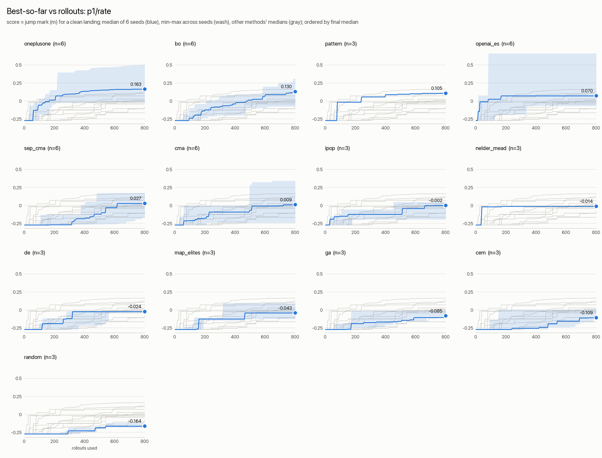
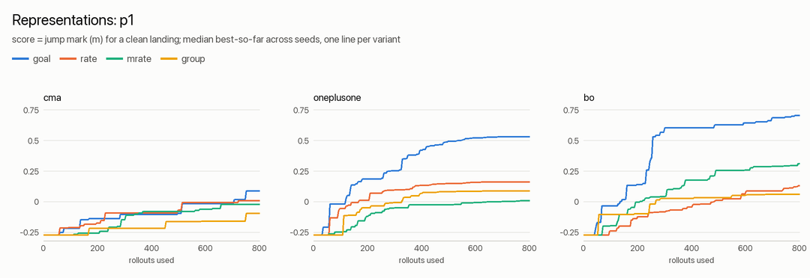
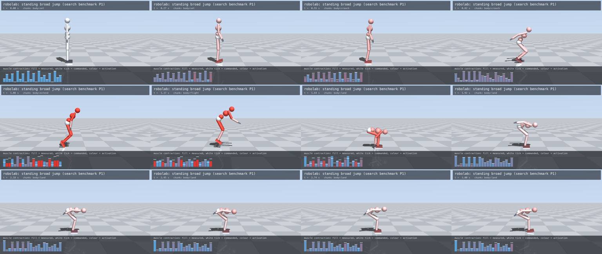
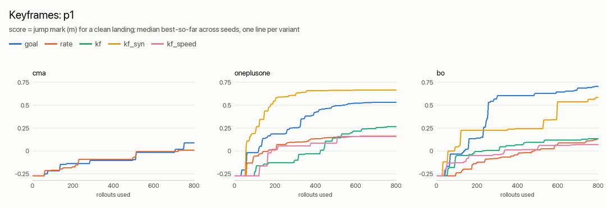
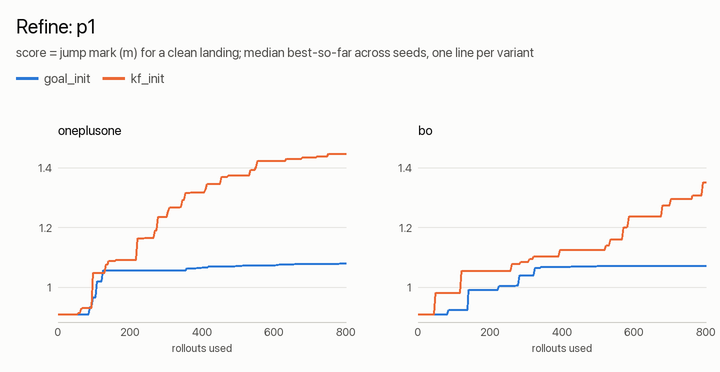
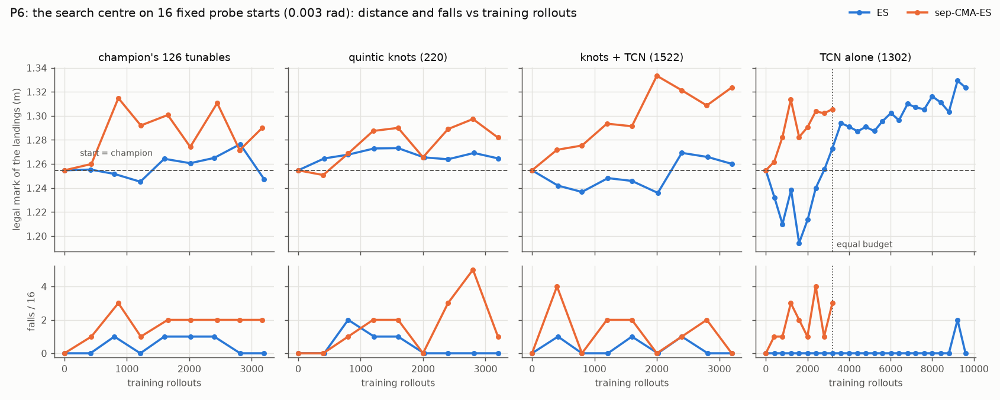
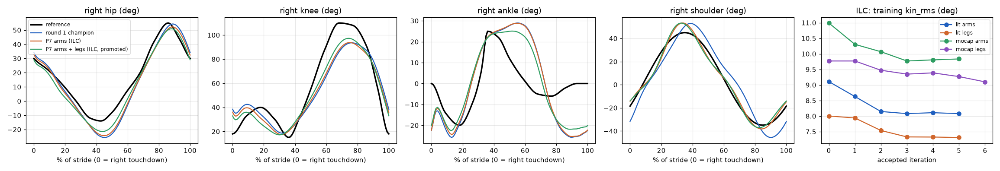
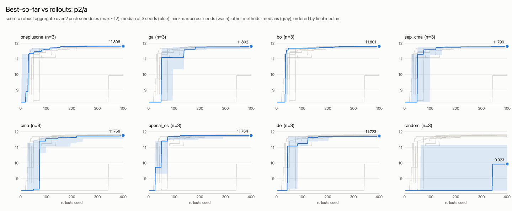
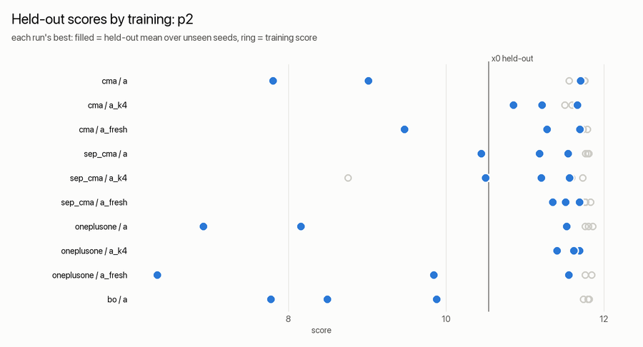
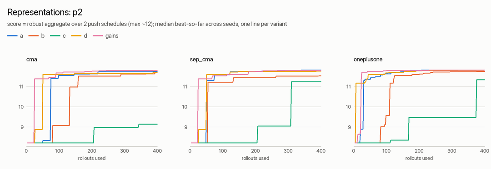

# Searching for contraction vectors, midpoints and velocity vectors

A robolab skill is chunks whose goals are contraction vectors or postures
(equilibrium midpoints the reflexes hold), reached along eased
contraction-rate ("velocity") vectors over a duration, with drives, gains and
spring-eased corrections. Every number in that is a tunable
(`param(name, default, lo, hi)`). This page is the evidence for how to search
them: 13 derivative-free methods behind one ask/tell interface, four ways to
parametrise a midpoint, four ways to parametrise a movement plus its easing,
benchmarked at equal rollout budgets on three problems, every found solution
re-scored on held-out seeds.

## Recommendations

| problem type | method | representation | budget and scoring |
| --- | --- | --- | --- |
| **Ballistic, choreographed motion** (a jump, a throw: chunk goals, durations, drives; ~40-60 tunables, deterministic, very multimodal) | `bo` (TuRBO-style) or `oneplusone`; run 3+ independent seeds and keep the best | **goal posture + duration** per chunk to find the motion; then **refine it as per-muscle contraction keyframes** (0.91 -> 1.3-1.5 m); **latch the phase changes on the COM** (take-off, touchdown), not on the last contact, before judging robustness (P5) | 800 rollouts per seed took a hop in place (-0.27 m) to a median 0.5-0.7 m (best 0.91 m); the outcome varies more between seeds than between the good methods; tune the latches on **8 starts at 3x the target perturbation** (4 starts at the target size overfit) |
| **Posture and gain tuning under perturbations** (balance, holding; ~10-25 tunables, stochastic) | `sep_cma` (or `cma`); anything rank-based and non-elitist | the reflex and balance gains first (they carry the result); add a low-dimensional posture (hand-designed symmetric, or synergies) only if the midpoint must move | 200-400 rollouts; **train on >= 4 fixed perturbations or on fresh ones every generation** (2 fixed ones overfit badly); never (1+1)-ES / DE / GA with fresh noise |
| **Refining a practised high-dimensional skill** (the run: 73 tunables, already at a CMA-ES optimum) | `sep_cma` with a **small step, sigma 0.02**; with a large step (0.08) only `bo` (sparse trust-region moves) improves | the skill's tunables | 500 rollouts buy +1-3 % on the training starts; always re-check on held-out starts |

`practice.py` keeps CMA-ES as its default: nothing won everywhere, and at a
suitable step size CMA-ES is never far behind. Use `--method` per the table
(`python playground/practice.py <task> --method sep_cma --budget 400 --sigma 0.02 ...`).

What works for which kind of vector (details under Results):

- **Contraction vectors** (a midpoint as one number per muscle): do not search
  them raw. 80 per-muscle offsets were the slowest and least robust
  representation on the MyoSuite leg (only 2 of 9 runs reached a score of 11.5,
  after 370 rollouts; runs of the other representations took 20-290). **Synergies** distilled from
  good solutions (the 6 leading directions of the elite contraction-offset
  vectors, the SAR idea) were the fastest posture representation (median 50
  rollouts to 11.5, against 74-98 for the symmetric posture and 124-262 for
  joint space) and about as robust as the joint-space postures. The two
  leading synergies are interpretable: per-side subtalar co-contraction (peroneus brevis and longus
  lengthened, tibialis posterior shortened), i.e. lateral ankle stiffening.
- **Midpoints** (postures): a joint-space posture turned into contractions
  through Geometry (14 joints) and a hand-designed 5-number symmetric posture
  both work; the symmetric one converges faster. But on this balance task the
  reflex and balance gains carry most of the result: searching the 11 gains
  alone, with the posture left at the start posture, reached the same
  training score fastest of all (a median 24-90 rollouts to 11.5) and held up
  best on unseen pushes (3-9 falls in 30 against 4-25 for the posture
  representations). The midpoints the searches settled in stay a slight
  crouch a little straighter than the start (held knee 0.40 rad median over
  all runs, start 0.48), and no single tunable separates robust from fragile
  solutions (correlations with
  held-out survival at most 0.2; the clearest is the ankle-strategy gain
  k_ap, median 2.6 in solutions that survived >= 90 % of the unseen pushes
  against 1.8 in those that survived <= 50 %).
- **Velocity vectors** (movement): parametrise a chunk by its **goal posture and
  duration**, not by a rate vector and duration. With rates, each chunk's goal
  is the sum of every earlier rate x duration, so one change in the crouch
  moves every later posture; with goals the tunables are independent. Median
  best over 6 seeds: BO 0.71 m (goal) vs 0.13 m (joint rate), (1+1)-ES 0.53 vs
  0.16. Per-muscle rates (64 tunables, co-contraction free) only worked with
  BO (0.31). Giving each joint group its own push-off onset and duration (the
  `Chunk#stagger` idea; here separate tracks) did not help at this budget
  (0.06-0.09): the extra timing freedom mostly produced falls.
- **Keyframes** (a movement as a series of full contraction vectors, eased
  between): search from scratch in postures or in a synergy basis of
  contraction keyframes (both reach ~0.6-0.7 m); raw 22-muscle keyframes from
  scratch reach only 0.13-0.27 m, and giving each segment a speed instead of a
  duration is worse still. But converting the best posture solution to
  contraction keyframes and refining those in muscle space is the best result
  of the study (0.91 m -> 1.31-1.52 m, joint space stalls at 1.04-1.28 m). All
  of them fall on perturbed starts; the arena keeps the original jump. See
  "P1: keyframes".
- **Easing**: search it per chunk (a categorical tunable). The push-offs the
  searches chose were `linear` or `cubic_in` (the burst front-loaded or
  rising), never `min_jerk`'s slow start; the crouch kept a smooth
  `sine_in_out` / `min_jerk`.
- **Robustness is a skill-design question, not a search one.** Every jump found
  (and the hand-designed hop) falls on perturbed standing starts; see
  "Robustness" below. The cause was one latch: the flight began when the
  *last toe* left the floor, and a toe that lingers a few ticks from a
  perturbed start delays the tuck. Latching the take-off on the COM (and the
  landing on the COM being low and falling) lands 25 of 25 validation starts
  with the same jump; the latched keyframe jump, refined by (1+1)-ES on
  perturbed starts with a take-off-line rule, jumps a legal 1.26 m and lands
  every validation start at 0.001 and 0.003 rad (see "P5: feedback").
  Enforce the rules in the score before searching hard: the refinements
  without them learned to step over the line and to end head down.
- **A learned feedback residual on top of the keyframes** (P6): keyframes
  with velocity and acceleration vectors (quintic knots) are a linear
  convolutional decoder, and a small residual causal TCN on proprioception
  (zero-initialised head) trained jointly with them by sep-CMA-ES on
  perturbed starts took the legal jump from 1.27 to 1.33 m with no fall on
  any arena start (both jump trials' champion). On a polished motion, steps
  must be tiny (σ 0.0015) and the fitness must keep the cost of a fall: rank
  shaping trades landings for distance. Structure still comes first: without
  its latches the TCN cut the jump's falls from 27 to 12 of 32, where a
  three-number COM latch removed them.
- **A gait as a knot train, fitted, then learnt on the body** (P7): the
  runner's stride as quintic knots at its gait events (left step mirrored)
  fits mocap, literature and keyframe targets to 0.1-0.6 deg by least
  squares with zero rollouts; iterative learning control from event-locked
  per-stride error curves then learns the command-to-motion gap in a few
  hundred rollouts (the literature runner 9.13 -> 7.29 deg on every landed
  arena start: `run_natural`'s champion). Run the train as a zero-initialised
  residual on a working gait (on its own it fell), and add P6's residual TCN
  for the falls (14 -> 4 of 48 held-out starts on the mocap runner): ILC
  learns kinematics, not balance.

## Files

| file | what |
| --- | --- |
| `playground/search.py` | the library: 13 optimizers (ask/tell over [0, 1]^n), representations (`BoxRep`, `SynergyRep`), `Problem` (task, representation, training seeds or fresh seeds per generation, task attributes such as the start perturbation, robust aggregate), `Search` (one optimizer under a rollout budget: per-generation JSONL log, full-precision best params, archive of every candidate) and `run_searches` (several searches in lockstep over one worker pool, so sequential methods keep the workers busy). Also a CLI. |
| `playground/search_bench.py` | the benchmark: problems P1-P5 and their variants, resumable runs, held-out evaluation, x0 baselines, re-checks under other perturbations, and the synergy-basis distillation |
| `playground/search_report.py` | tables (`table.md`), curves (`curves.csv`) and figures (`curves.png`, `heldout.png`, per-problem comparisons) |
| `playground/practice.py --method <name> [--budget N]` | practice with any method; plain `cma` without `--budget` runs the original loop unchanged |
| `lib/robolab/skills/search_jump.w`, `lib/entry/search_jump.w`, `playground/tasks/search_jump.py` | P1: standing broad jump, planar humanoid (the task also reports `toe_advance`, `foul`, `inverted`; `strict` scoring is opt-in) |
| `lib/robolab/skills/search_balance.w`, `lib/entry/search_balance.w`, `playground/tasks/search_balance.py` | P2: push-recovery balance, MyoSuite chase-tag myoLeg |
| `playground/tasks/search_run.py`, `bin/frozen/robolab_run`, `params/search/run_frozen_init.txt` | P3: frozen copy of the running skill, its task and its practised params (2026-09-26 02:40) |
| `bin/frozen/robolab_search_{jump,balance}` | the frozen controller builds every run used (the tasks point at them) |
| `playground/tasks/search_jump_v2.py`, `playground/tasks/search_hops.py`, `bin/frozen/robolab_search_jump_v2` | the keyframe study: P1 on the v2 controller (reps 4, 5 and `loop`), P4 consecutive jumps |
| `params/search/jump_keyframe_synergies.npz` | the keyframe synergy basis (4 directions per keyframe) |
| `playground/tasks/search_jump_v3.py`, `bin/frozen/robolab_search_jump_v3` | P5: the jump with opt-in feedback switches (`fb_push`, `fb_takeoff`, `fb_touch`, `fb_flight`, `fb_land`, `fb_stand`); replays every earlier run exactly |
| `params/search/jump_posture_latch.txt`, `jump_kfbo_latch.txt`, `jump_kfbo_refined.txt`, `jump_kfbo_legal.txt` | the P5 arena challengers: the posture jump with hand-set latches; the BO-refined keyframes with searched latches; those fully refined with lenient scoring (a foul: a 0.17 m step before the take-off) and with strict scoring (legal) |
| `params/search/balance_synergies.npz` | the synergy basis (6 x 80, with each coefficient's range) |
| `playground/convkf.py`, `playground/convkf_plot.py` | P6: the TCN's numpy mirror (bit-exact streaming form, vectorised form), the parity test, the step-size scan, antithetic OpenAI-ES and sep-CMA-ES over knots and TCN weights (`train`, `--resume`, `--base`), validation and the learned-policy analysis; the learning-curve figure (matplotlib: `.venv-pose`) |
| `lib/robolab/tcn.w`, `Chunk#knot`, `Quintic` (`easing.w`) | P6: the residual causal TCN (`ConvPolicy`, `CausalConv`) and the quintic Hermite keyframes |
| `playground/tasks/search_jump_convkf.py`, `bin/frozen/robolab_search_jump_convkf` | P6: the jump with `kf_knots` and `tcn` switches (replays both legal champions exactly without them, with zero knots and with a zero TCN head) |
| `params/search/convkf_*.txt` | P6: the TCN normalisation and initial weights, the latch-less P6b start, and each arm's arena challenger |
| `lib/robolab/skills/run_knots.w`, `lib/entry/run_knots.w`, `bin/challengers/run_knots-p7` | P7: `RunKnotsSkill` (a `RunNaturalSkill`): the stride as quintic knot chunks (`knots 1`: phase-timed or fixed `kt_*`, `knot_from`), or the knot train as a zero-initialised residual on the posture keyframes (`knot_residual 1`, `knot_mid`, `res_from` / `res_ramp`), the command trace (`knot_trace`), a trunk-lean speed loop (`k_vlean`), a residual TCN with per-joint outputs (`tcn 1`) |
| `playground/runknots.py`, `playground/runknots_plot.py` | P7: posture -> contraction targets through MuJoCo's actuator lengths, the event-locked quintic basis and least squares (`fit`), iterative learning control (`ilc`), knots + TCN by raw-difference ES (`train`, chunked with `--resume`), `eval`, `cycles`, `render` (the reference ghosted at the current stride phase); the figure (`.venv-pose`) |
| `playground/kfdrop.py`, `params/search/{runknots,rn2}_erik3_{nohr,noto,tdto_*}.txt`, `playground/search_results/p7b/` | P7b: the keyframe ablation files (reduced sets, rn2 starts) and evaluation (full / reduced / literature kin_rms, per-event errors), the TD + TO and HR / TO variants and their evaluations |
| `params/search/runknots_*.txt`, `playground/search_results/p7/` | P7: the arena challengers (ILC arm / leg knots per target, the mocap knots + TCN), the fits, ILC and ES logs, the held-out validations and the figure |
| `playground/search_results/` | the durable copy (`search_report.py export`): every variant's `table.md`, `curves.csv`, `curves.png`, `heldout.png`, `baseline.json`, the comparison figures, renders, and `runs.json` (all 231 runs: best params, curve, held-out scores, file fingerprints) |
| `out/search/<problem>/<variant>/` (git-ignored) | the raw runs: `<method>_s<seed>.json` (summary), `.jsonl` (per generation), `.npz` (every candidate and its score), `.txt` (best params); logs in `out/search/logs/` |

## The methods

All start from the same x0 (the skill's defaults or a params file) with the
same initial scale sigma0 in the normalised box, and x0 itself is every run's
first rollout. Candidates outside the box are clipped for the rollout
(CMA-type methods also see practice.py's 10 x L1 penalty).

| method | what | behaved |
| --- | --- | --- |
| `cma` | CMA-ES, full covariance (practice.CMA) | solid everywhere with a sensible step; never the clear winner |
| `sep_cma` | separable CMA-ES (diagonal, learning rates x (n+2)/3; Ros & Hansen 2008) | best on noisy / perturbed objectives (P2 held-out) and on small-step refinement (P3) |
| `ipop` | CMA-ES + IPOP restarts (population doubles; restart at the incumbent on stall or collapse) | restarts threw away progress at these budgets (below CMA on P1) |
| `ga` | real-coded GA: tournament 3, SBX eta 15, polynomial mutation eta 20 at 1/n, elitism 2 | slow; overfits noise (elitist) |
| `oneplusone` | (1+1)-ES random walk with the 1/5th success rule | among the best on deterministic P1; worst under noise (keeps lucky parents) |
| `random` | uniform random search | baseline: never competitive past x0 on P1/P3; on P2 its best was often x0 itself |
| `cem` | cross-entropy method, diagonal Gaussian, elite 20 %, smoothing 0.7, decaying extra noise | weak (collapses) |
| `de` | differential evolution rand/1/bin (NP 20, F 0.6, CR 0.9) | too few generations at these budgets |
| `openai_es` | antithetic NES / OpenAI-ES: centred ranks, Adam, fixed sigma | fast early on P2, middling after; no progress on P3 |
| `nelder_mead` | Nelder-Mead with Gao-Han coefficients, restarts | useless at n = 40 (and deterministic: every seed identical) |
| `pattern` | compass search: poll +-step on all axes, double / halve | steady but slow (2n rollouts a step; deterministic) |
| `bo` | Bayesian optimisation in a TuRBO-style trust region: GP (Matern 5/2, marginal-likelihood grid) + expected improvement, batch 2 by kriging believer, ~20/n coordinates perturbed per candidate | best on P1 (goal rep) and the only method that improved P3 at the large step; ~60 s of GP fitting per 800-rollout run |
| `map_elites` | MAP-Elites (iso+line mutation) over a 10 x 10 behaviour grid (P1: take-off velocity) | covers 56-65 % of the grid, but its best jump is poor: for a repertoire, not a record |

## The problems

All physics is honest: normal muscle strength (no strength or speed
scaling), no assist forces, no qpos edits during a rollout (perturbed starts
are set at reset; P2's pushes are disturbances on the pelvis).

**P1, standing broad jump** (planar robolab humanoid; `search_jump`). set ->
crouch -> extend (a drive burst on the hip, knee and ankle extensors and the
arm swing) -> flight -> land: velocity vectors, timing, drives and gains, 40
tunables in the main representation. Score: the athletics mark (take-off line
to the nearest floor contact after landing) for a clean landing; a fall
scores -0.5 + 0.25 max(0, mark), so every clean landing beats every fall (a
dive onto the hands would otherwise "jump" 1.3 m); no take-off scores -1.
The hand-designed default is a clean hop in place (-0.27 m: the heels land
behind the toes' start line). Deterministic, trained on the clean standing
start, held out on 8 perturbed starts (leg and spine joints N(0, 0.04) rad,
pelvis pitch N(0, 0.02) rad). 800 rollouts per run; 6 seeds for the leading
methods, 3 for the rest.

**P2, push-recovery balance** (MyoSuite `myoChallengeChaseTagP1-v0`: the
myoLeg, 80 muscles on wrapped tendons, 14 leg joints; `search_balance`). One
chunk eases to the standing midpoint and holds it through the reflexes;
ankle, hip and lateral (hip ab/adduction) corrections close the balance
loops. Three 0.2 s pushes on the pelvis per 5 s rollout (56-168 N, random
horizontal directions, the last the hardest). Score per rollout: 10 x the
fraction of the horizon before a fall + 2 if it never fell - 2 x sway (RMS
COM speed) - foot drift - 4 x effort (max ~12). A candidate's score is the
robust aggregate mean - 0.5 (mean - min) over its training push schedules
(1 and 2), and every best is re-scored on schedules 101-110. The start (the
model's standing keyframe held with the default gains) scores 8.2 on the
training schedules and survives 7 of the 10 held-out ones. 400 rollouts per
run (200 candidates), 3 seeds.

**P3, the running skill, frozen** (`search_run`: `bin/robolab_run` and
`tasks/run.py` copied at 02:40, 73 practised tunables). Starts at the
practised params, already a CMA-ES optimum (141.1 over 20 s from the clean
start). Trained on the clean start and one perturbed start (20 s each), held
out on the clean start and 5 perturbed ones. 500 rollouts per run, 3 seeds,
two initial step sizes.

**P5, the jump with feedback, trained on perturbed starts** (`search_jump_v3`:
P1's task on a controller with opt-in feedback switches). Starts from the
best P1 jumps with feedback switched on; trained on 4 starts perturbed by the
arena's 0.001 rad (1001-1004), or with `_n3` on 8 starts at 0.003 rad
(1001-1008), robust aggregate as P1 (a fall scores -0.5 + 0.25 x mark, so any
fall costs more than any distance gains). Validated on the clean start plus
2001-2024 at 0.001 rad and 4001-4024 at 0.003 rad; the arena's own starts
(`search_jump`: 0, 101-107; `search_jump_robust`: 3001-3032 at 0.003 rad)
decide, and are never used to choose.

**P6, the jump as a convolutional keyframe policy** (`search_jump_convkf`: the
P5 controller plus quintic knots and a residual TCN). Starts from the P5
legal champion (1.27 m) with zero knots and a zero TCN head, which replay it
exactly; strict scoring, trained on fresh starts at 0.003 rad (seeds from
100000 and 200000), probed on 6001-6016 and validated on 6101-6132; 3200
training rollouts per run; the arena's legal trials decide.

## Results

Scores are the task scores above; "best @25 %" is the best-so-far after a
quarter of the budget; held-out means are medians over seeds of each run's
held-out mean; fails count held-out rollouts that fell. Every table, curve
file and figure is under `search_results/` (raw runs in `out/search/`); the
numbers below are copied from those `table.md` files.

### P1: methods (joint-rate representation, 40 tunables)



| method | seeds | best @25 % | final best: median [min, max] (m) |
| --- | ---: | ---: | --- |
| x0 (hand-designed hop) | - | -0.271 | -0.271 |
| oneplusone | 6 | 0.012 | **0.163** [-0.013, 0.500] |
| bo | 6 | -0.124 | 0.130 [-0.081, 0.304] |
| pattern | 3 | -0.017 | 0.105 (deterministic) |
| openai_es | 6 | 0.070 | 0.070 [-0.073, 0.658] |
| sep_cma | 6 | -0.270 | 0.027 [-0.171, 0.170] |
| cma | 6 | -0.176 | 0.009 [-0.242, 0.337] |
| ipop | 3 | -0.125 | -0.002 [-0.196, 0.045] |
| nelder_mead | 3 | -0.014 | -0.014 (deterministic) |
| de | 3 | -0.191 | -0.024 [-0.035, -0.015] |
| map_elites | 3 | -0.128 | -0.043 [-0.128, 0.092] |
| ga | 3 | -0.191 | -0.085 [-0.108, -0.014] |
| cem | 3 | -0.271 | -0.109 [-0.133, -0.001] |
| random | 3 | -0.271 | -0.164 [-0.185, -0.122] |

The landscape is rugged and heavy-tailed: CMA-ES led after 3 seeds (median
0.28) and fell to 0.01 after 6. Six seeds separate a leading group ((1+1)-ES,
BO, OpenAI-ES, pattern search) from the rest; within it, independent seeds
matter more than the method (the best single runs: OpenAI-ES 0.66, (1+1)-ES
0.50).

### P1: velocity-vector representations and easing



Median best over seeds (6 for goal / rate / mrate, 3 for group), same x0 hop:

| representation | tunables | bo | oneplusone | cma |
| --- | ---: | --- | --- | --- |
| goal posture + duration (rep 0) | 40 | **0.707** [0.187, 0.910] | **0.532** [0.164, 0.739] | 0.087 [-0.172, 0.611] |
| joint rate + duration (rep 1) | 40 | 0.130 [-0.081, 0.304] | 0.163 [-0.013, 0.500] | 0.009 [-0.242, 0.337] |
| muscle rate + duration (rep 2) | 64 | 0.312 [0.073, 0.536] | 0.007 [-0.169, 0.750] | -0.022 [-0.140, 0.367] |
| joint rate, per-group push-off onset + duration (rep 3) | 47 | 0.062 [-0.093, 0.191] | 0.088 [0.050, 0.125] | -0.095 [-0.212, -0.091] |

The best jump, 0.91 m (BO, goal representation, `search_results/p1/best_jump_params.txt`;
`.venv/bin/python playground/bridge.py search_jump --params playground/search_results/p1/best_jump_params.txt`),
takes off at 1.25 m/s forward and 1.32 m/s up and flies 0.44 s:


Easing (CMA-ES, joint-rate representation, seeds 1-3; a fixed easing changes
x0, which is no longer a clean hop):

| easing of every chunk | x0 | final best: median [min, max] |
| --- | ---: | --- |
| min_jerk (the default) | -0.271 | 0.281 [-0.227, 0.337] |
| linear | -1.000 | -0.069 [-0.099, 0.067] |
| cubic_in | -0.500 | -0.030 [-0.098, -0.028] |
| cubic_out | -0.500 | 0.267 [-0.203, 0.435] |
| step | -0.500 | 0.211 [-0.402, 0.323] |
| searched per chunk (categorical) | -0.271 | **0.289** [0.057, 0.578] |

The searched easings: crouch `sine_in_out` / `sine_in_out` / `min_jerk`;
push-off `linear` / `linear` / `cubic_in`; flight `linear` / `cubic_in` /
`step`.

### P1: robustness

Every jump found, and the hand-designed hop, falls on the perturbed standing
starts (83-100 % of held-out starts for every method and representation
trained on the clean start). The jump is open loop from
the crouch on (only the set and crouch chunks carry a balance correction), and
it is a chaotic system. The hand-designed hop falls from every perturbed
start even at 0.001 rad of joint noise (it lands on the verge of sitting
back); the best jump (0.91 m) survives 0.001 rad in 6 of 8 starts, 0.003 rad
in 2 of 8 and 0.01 rad in 1 of 8 (`search_results/p1/sensitivity.log`), and the
held-out noise is 0.04 rad. Training on the clean start plus two perturbed
starts (`rate_robust`, same 800 rollouts) cuts the training score but helps
held-out: (1+1)-ES fails 71 % of held-out starts (17/24) instead of 100 %
(48/48), BO 79 % (19/24) instead of 83 % (40/48). A robust jump needs
feedback in the push-off and flight (latches on the COM, a landing
correction), not a better optimizer.

### P1: keyframes (a movement as a series of contraction vectors)

The question: instead of joint postures, make each chunk go from one full
per-muscle contraction vector to the next (all 22 muscles of the planar body,
left and right free), eased min-jerk, either over a duration or at a speed.
Controller `bin/frozen/robolab_search_jump_v2` (task `search_jump_v2`, which
replays every earlier representation's stored runs exactly): rep 4 = 4
keyframes x 22 contractions + 4 durations (104 tunables with the drives and
gains), rep 5 = the same keyframes + a speed per segment (contraction per
second; a segment lasts its largest muscle change / speed). All start from
the same hop; 800 rollouts per run.



| representation | tunables | method | seeds | final best: median [min, max] (m) | runs reaching 0.3 m (median rollouts) | held-out fails, 0.04 / 0.01 rad starts |
| --- | ---: | --- | ---: | --- | --- | --- |
| goal posture + duration (the reference) | 40 | bo | 6 | **0.707** [0.187, 0.910] | 4/6 (148) | 44/48 / 33/48 |
| | | oneplusone | 6 | 0.532 [0.164, 0.739] | 5/6 (329) | 47/48 / 43/48 |
| (a) raw contraction keyframes + duration | 104 | bo | 6 | 0.134 [-0.002, 0.250] | 0/6 | 47/48 / 39/48 |
| | | oneplusone | 6 | 0.265 [0.050, 0.825] | 3/6 (568) | 47/48 / 40/48 |
| (b) synergy keyframes (4 per keyframe) + duration | 32 | bo | 3 | 0.583 [0.251, 0.832] | 2/3 (312) | 21/24 / - |
| | | oneplusone | 3 | **0.666** [0.183, 0.699] | 2/3 (**115**) | 22/24 / 17/24 |
| (d) contraction keyframes + speed | 104 | bo | 3 | 0.070 [0.061, 1.186] | 1/3 (519) | 18/24 / - |
| | | oneplusone | 3 | 0.157 [0.086, 0.825] | 1/3 (307) | 23/24 / 21/24 |
| (a) with linear easing | 104 | oneplusone | 3 | -0.049 [-0.210, 0.256] | 0/3 | 24/24 / 24/24 |
| (a) with easing searched per segment | 108 | oneplusone | 3 | -0.100 [-0.240, 0.065] | 0/3 | 24/24 / 24/24 |

(c) Refining the best posture jump (0.91 m) for 800 more rollouts at sigma0
0.05, in muscle space (its postures converted to contraction keyframes through
the same map the controller uses; x0 reproduces 0.91 m exactly) or in joint
space (the control):



| refined in | method | final best: median [min, max] (m) | runs reaching 1.2 m (median rollouts) |
| --- | --- | --- | --- |
| muscle space (contraction keyframes) | oneplusone | **1.446** [1.307, 1.522] | 3/3 (276) |
| | bo | 1.351 [1.137, 1.366] | 2/3 (420) |
| joint space (goal postures) | oneplusone | 1.080 [1.038, 1.276] | 1/3 (270) |
| | bo | 1.071 [1.069, 1.149] | 0/3 |

What this says:

- **From scratch, search postures, not raw contraction vectors.** The 64 extra
  numbers raw keyframes add (co-contraction and left/right differences per
  keyframe) are mostly new ways to fall: medians 0.13-0.27 m against 0.53-0.71
  m for the same 4 keyframes as postures.
- **A low-dimensional synergy basis rescues contraction keyframes.** 4
  directions per keyframe (a per-keyframe SVD of the keyframes of every clean
  jump >= 0.2 m in the earlier goal / rate / muscle-rate runs, 2232 jumps; 81-88
  % of the variance) matched the posture representation (median 0.67 m with
  (1+1)-ES) and reached 0.3 m fastest of all (115 rollouts). The basis is
  learned from earlier searches on the same task, so its runs do not count
  the rollouts that built it.
- **For refinement, contraction keyframes win clearly.** Starting from the best
  posture jump, muscle space took it from 0.91 m to 1.31-1.52 m in every run;
  joint space stalled at 1.04-1.28 m. Once the motion is right, per-muscle
  timing of co-contraction and small asymmetries are real gains that joint
  postures cannot express.
- **"From a beginning to an ending contraction at some speed" (rate as a
  speed) is the weakest form** (medians 0.07-0.16 m): a segment's duration
  then depends on its keyframes, so moving one keyframe also retimes the
  segment, the same coupling that made the joint-rate representation weak.
  Give each segment its duration and let the easing set the speed profile.
- **Easing between contraction keyframes: keep min-jerk.** Linear and a
  per-segment searched easing both did worse here (from scratch, 3 seeds);
  unlike the joint-rate representation, where a searched easing helped.
- **None of it is robust** (every representation fails 69-100 % of perturbed
  starts); the arena check below settles which jump to keep.

**Arena verdict** (trial `search_jump` in `playground/arena/trials.json`: the
clean start plus 7 starts perturbed by 0.001 rad, a fall scores the worst
value, paired comparison against the champion). The champion, seeded with
the 0.91 m goal-posture jump, lands 6 of the 8 starts (mean mark 0.75 m over
those). Each representation's best run challenged it and lost on falls:

| challenger (best run of the representation) | clean-start mark | falls on the 8 arena starts | verdict |
| --- | ---: | ---: | --- |
| goal postures refined (goal_init, (1+1)-ES s3) | 1.276 m | 3/8 | loses (p = 0.52) |
| raw contraction keyframes (kf, (1+1)-ES s5) | 0.825 m | 3/8 | loses (p = 0.71) |
| contraction keyframes refined from postures (kf_init, (1+1)-ES s2) | 1.522 m | 4/8 | loses (p = 0.77) |
| synergy keyframes (kf_syn, (1+1)-ES s3) | 0.699 m | 5/8 | loses (p = 0.94) |
| keyframes at a speed (kf_speed, (1+1)-ES s3) | 0.825 m | 5/8 | loses (p = 0.80) |

Every gain on the clean start was bought with fragility. The next step for the
jump is feedback (a take-off latch on the COM, a landing correction) and then
robust training on perturbed starts, in whichever representation: done in
"P5: feedback", whose challengers took both jump trials.

### P4: a periodic movement (consecutive broad jumps)

`search_hops`: the same skill with `loop` 1 (after each landing, held
land_hold s, it crouches, pushes and flies again with the same keyframes),
scored by the distance travelled in 6 s before a fall, -1 for falling;
(1+1)-ES, 3 seeds, 800 rollouts. A first run was discarded: its best "gait"
(8.2 m) was the body folded head-down sliding on its feet, which the fall
check (non-foot floor contact, COM below 0.5 m) missed; the task now also
counts the head dropping below the pelvis as a fall.

| representation | final best: median [min, max] | distance before the fall (m), hops |
| --- | --- | --- |
| goal posture + duration | 0.644 [0.539, 1.184] | 1.5-2.2, 2-3 hops |
| contraction keyframes + duration | **1.261** [1.176, 1.720] | 2.2-2.7, 1-3 hops |
| synergy keyframes | 0.363 [0.258, 0.682] | 1.3-1.7, 0-2 hops |
| contraction keyframes + speed | 1.717 [1.159, 1.937] | 2.2-2.9, 0-1 hops (lunges) |

No representation found a sustained bounding gait in 800 rollouts: every run
falls after 1-3 jumps (1.6-5.5 s), and every held-out start (0.01 rad) falls
too. Contraction keyframes travel furthest before the fall, the speed form
mostly by lunging rather than jumping. A periodic keyframe loop needs what the
single jump needs first: feedback that re-plans the next push from the
landing state (the looped chunks replay the same goals whatever the last
landing did).

### P5: feedback (why the jumps fell, and the latch that fixes it)

The keyframe study ended with every jump falling on perturbed starts. P5 adds
feedback to the jump skill as params-file switches, each declaring its own
tunables only when on (`lib/robolab/skills/search_jump.w`; controller
`bin/frozen/robolab_search_jump_v3`, task `search_jump_v3`). Without the
switches the build replays all 177 stored P1 / P4 runs (1584 rollouts) and the
arena champion and its 5 challengers exactly.

| switch | what |
| --- | --- |
| `fb_takeoff` | the flight (tuck) starts when both feet are off **or** the COM has risen above `to_z` while moving up |
| `fb_touch` | the landing latch needs the COM below `td_z` and falling (a toe scuffing the floor mid-flight is ignored) |
| `fb_push` | the push-off starts when the COM sinks below `push_z` (the countermovement's depth), not on the crouch's clock |
| `fb_flight` | hips and arms steer the trunk pitch in flight (angular momentum is fixed, so legs and arms move against the trunk); a faster take-off reaches the legs further |
| `fb_land` | capture-point landing correction: from COM + vx sqrt(z / g) against the feet's centre, ankles, hips, knees, spine and arms (forward only) bring the COM over the feet; the hips also servo the trunk pitch; leg co-contraction `land_cc`; eased in through the correction spring |
| `fb_stand` | after landing, rise to a balanced crouch (its static COM checked over the feet) with the landing correction on |

**Root cause.** The extend (push-off) chunk ended when *both feet* had left
the floor. From a perturbed start one toe sometimes lingers or chatters on
the floor for a few ticks after the body is airborne, so the tuck started
~80 ms late and the body landed with the legs still behind it: the hands hit
the floor at touchdown. That is every fall of the arena champion (starts 101
and 107; 3 of 25 validation starts). The refined keyframe jumps add two more
modes: a foot scuffing the floor mid-flight fired the landing latch in
mid-air (head first), and after landing the COM ends behind the heels and the
body slowly sits back (a hand down at 2.4-3.0 s; even their clean-start
"successes" were drifting back at 0.3-0.9 m/s when the 3 s trial ended).

Falls on the validation starts (clean + 2001-2024 at 0.001 rad; 4001-4024 at
0.003 rad) and the mean mark of the clean landings:

| jump | feedback | tuned how | falls 0.001 | falls 0.003 | mark (m) |
| --- | --- | --- | ---: | ---: | ---: |
| posture jump (arena champion, 0.91 m clean) | none | - | 3/25 | - | 0.753 |
| | `fb_takeoff` alone (`to_z` 0.93) | hand-set | **0/25** | - | 0.760 |
| | `fb_takeoff` + `fb_touch` | hand-set (`to_z` 0.93, `td_z` 0.8) | **0/25** | 1/24 | 0.760 |
| | | sep-CMA, 3 tunables, 4 starts at 0.001 (400 rollouts) | 3/24 | - | 0.748 |
| | | sep-CMA, 3 tunables, 8 starts at 0.003 (800) | **0/25** | 1/24 | 0.776 |
| refined keyframes (kf_init (1+1)-ES s2, 1.522 m clean) | none | - | 15/25 | - | 1.489 |
| | `fb_touch` + `fb_land` | default gains | 12/25 | - | 1.452 |
| (a) | `fb_touch` + `fb_land` + `fb_stand`, landing gains and stand posture searched | sep-CMA, 22 tunables, 4 starts at 0.001 (1600), 2 seeds | 10/24, 13/24 | - | 1.38, 1.44 |
| (b) | (a) + `fb_push` + `fb_takeoff` | sep-CMA, 26 tunables, 4 starts at 0.001 (1600), 2 seeds | 4/24, 8/24 | 10/24 (the first) | 1.44, 1.47 |
| BO-refined keyframes (kf_init BO s1, 1.366 m clean) | none | - | 4/8 (training starts) | - | 1.33 |
| | `fb_takeoff` + `fb_touch` | sep-CMA, 3 tunables, 8 starts at 0.003 (800) | **0/25** | 2/24 | **1.183** |
| | every tunable (126: keyframes, durations, drives, gains, five feedback switches, all but `fb_stand`) | sep-CMA, sigma0 0.03, 8 starts at 0.003 (4000) | 0/24 (never left its start) | - | 1.183 |
| | | (1+1)-ES, sigma0 0.03, 8 starts at 0.003 (4000) | 0/25 (lenient) | 0/24 (lenient) | 1.345, **foul: a 0.17 m step before the take-off** |
| refined keyframes (b)'s best (s2) | every tunable (135) | sep-CMA, sigma0 0.03, 8 starts at 0.003 (4000) | 0/24 (lenient) | - | 1.19, **fouls: 0.21 m step, ends head down** |
| | | (1+1)-ES, same | 0/24 (lenient) | - | 1.87, **fouls: 0.61 m step, ends head down** |
| BO-refined keyframes + searched latches | every tunable (126), **strict (legal) scoring** | (1+1)-ES, sigma0 0.03, 8 starts at 0.003 (4000), 2 seeds | **0/25**, 0/24 | **0/24** | **1.264**, 1.105 (legal: toe advance <= 0.009 m) |
| BO-refined keyframes, legal 1.264 m jump | every tunable (126), strict scoring, continued | (1+1)-ES, sigma0 0.02, 8 starts at 0.003, stopped at 1032 of 4000 rollouts (machine load) with no improvement | - | - | 1.264 |
| posture jump + hand-set latches (d') | every tunable (62), strict scoring | (1+1)-ES, sigma0 0.05, 8 starts at 0.003, stopped at 3360 of 4000 rollouts (machine load) | 5/25 | 4/24 | 1.038 (overfit to its 8 starts) |

What this says:

- **One latch was the problem.** A phase change triggered by the *last*
  contact to end is fragile, because contact at the end of a push is noisy:
  a toe can linger or chatter for a few ticks. Latching the take-off on the
  COM rising past a height, the way a jumper feels leaving the ground, made
  the champion's own motion land every validation start at 0.001 rad, without
  retraining.
- **After the latches, refine everything with (1+1)-ES on hard starts.**
  From the latched 1.18 m keyframe jump, (1+1)-ES over all 126 tunables on 8
  starts at 0.003 rad reached a legal 1.26 m that landed every validation
  start at both perturbation sizes; sep-CMA-ES at the same step never left
  its start (every sample fell somewhere). The elitist (1+1)-ES keeps a
  robust parent and only accepts children that land every training start,
  which is the constraint that matters here; P2's caution about (1+1)-ES
  applies to fresh noise, not to fixed starts. The same search from the
  posture jump overfit its 8 starts (5 of 25 validation falls).
- **A landing correction does not rescue a marginal landing.** The refined
  keyframe jump lands with the COM ~0.2 m behind the ankles, having lost its
  forward speed in the impact, and no gains on the ankles, hips, arms or a
  rise-to-stand kept it from sitting back (10-13 of 24 falls after 1600
  rollouts). A jump that lands a little shorter with the COM nearer the feet
  (the BO-refined keyframes, 1.37 m clean) became robust with the latches
  alone.
- **Train the latches on more, larger perturbations.** On 4 starts at the
  arena's 0.001 rad, sep-CMA moved `to_z` to 1.04 (the latch almost never
  firing) for +0.01 m, and fell on 3 of 24 validation starts. Four starts
  cannot see a 10 % fall rate. On 8 starts at 0.003 rad the same search kept the
  latch (`to_z` 0.97; 0.91 on the keyframe jump) and validated with no falls
  at 0.001 rad.
- The landing latch the searches chose, `td_z` 0.51-0.67 m, is low: the
  landing posture waits until the COM has sunk well into the landing, so
  the flight tuck absorbs the impact.
- **Once falls cost everything, the searches found the metric's loopholes.**
  The mark is measured from the take-off line (the toes at the start), and
  nothing stopped a foot stepping forward during the crouch: the full
  refinements learned a 0.17-0.61 m step before the jump (the 1.87 m
  "jump" is a lunge and a leap), and two of them ended jack-knifed on their
  feet with the head below the pelvis, which the fall check (a non-foot floor
  contact, or the pelvis below 0.5 m) does not see. P4 met the second
  loophole before. The earlier P1 records carry a little of the first (the
  1.522 m keyframe jump's toe gets 0.08-0.10 m past the line; the 0.91 m
  posture jump's 0.003 m). The task now reports `toe_advance`, `foul` (more
  than 0.03 m) and `inverted`, without changing any stored score; `strict`
  scoring (P5's `_legal` variants) makes either one a fall, and an arena
  trial enforces them with the guard `{"foul": false, "inverted": false}`.

**Arena verdicts.** The trial `search_jump` (8 starts) cannot promote a
challenger that only removes the champion's falls: a fall scores the worst
value, so 2 nonzero paired differences give p >= 0.25 however large they are.
The coordinator added `search_jump_robust` (32 starts at 0.003 rad,
3001-3032, disjoint from P5's training and validation starts), seeded with
the same champion, which lands 9 of its 32 starts.

| challenger | `search_jump` (8 starts at 0.001 rad) | `search_jump_robust` (32 starts at 0.003 rad) |
| --- | --- | --- |
| champion (posture jump, no feedback) | lands 6/8, mean 0.75 m | lands 9/32 |
| posture jump + `fb_takeoff` + `fb_touch`, hand-set | lands 8/8, mean 0.768 m; loses (p = 0.25: only 2 nonzero differences, and the clean start is 0.07 m shorter) | lands 31/32, mean 0.793 m; **promoted** (p < 0.001) |
| BO-refined keyframes + searched latches (`kfbo_latch_n3`) | lands 8/8, mean **1.176 m**; **promoted** (p = 0.004) | lands 26/32, mean 1.187 m; loses to the posture jump + latch (p = 0.97) |
| BO-refined keyframes + latches, all 126 tunables refined ((1+1)-ES, `kfbo_all_n3`, lenient scoring) | lands 8/8, mean **1.350 m**; **promoted** over the 1.176 m jump (p = 0.004), **but it is a foul**: the right foot steps 0.17 m past the line before the take-off, which is all of its gain (see below) | lands 31/32, mean 1.337 m; does not beat the posture jump + latch (p = 0.26: each falls on one start, a different one, so two opposite worst-value differences decide the test) |
| the same, refined with strict (legal) scoring (`kfbo_refine_n3_legal`) | lands 8/8, mean 1.267 m, all legal; loses to the 1.350 m foul (p = 1.0) | lands **32/32**, mean **1.251 m**; **promoted** (p < 0.001) |

Re-scored with the legality guard added (`foul` and `inverted` must be
false; computed in memory on each trial's own starts, nothing written):

| jump | `search_jump`: legal landings, mean legal mark | `search_jump_robust`: legal landings, mean legal mark |
| --- | --- | --- |
| posture jump (original champion) | 6/8, 0.752 m | 9/32, 0.741 m |
| posture jump + latches | 8/8, 0.768 m | 31/32 (1 head-down ending), 0.793 m |
| BO-refined keyframes + latches | 6/8 (2 fouls), 1.190 m | 20/32 (6 falls, 8 fouls, 3 head-down), 1.186 m |
| the same, refined, lenient scoring (the `search_jump` champion) | **0/8 (8 fouls, toe 0.17 m past the line)** | **0/32 (32 fouls)** |
| the same, refined, strict scoring | **8/8, 1.266 m** | **31/32 (1 head-down ending), 1.250 m** |

So the `search_jump` trial's current champion is a foul on every start;
the legal best is the strictly refined jump. The existing trials cannot
change their guard, so the fix is a trial that carries it (the guard above,
on either trial's starts); P5 recommends one before the next jump challenge.

**For the long jump** (`lib/robolab/skills/long_jump.w`, task `long_jump_v2`,
another study's; not changed here). Its take-off chunk ends on the same
kind of event, the plant foot's lowest point rising above 15 mm
(`foot_lifted`), and the standing variant's push on every toe and heel being
off the floor (`airborne`); the flight chunks already have COM-based timing
(`time_to_land`) and an air and a landing correction. What P5 suggests, in
order: (1) end the take-off on the COM too (`Latch.any` of the foot
releasing and the COM rising past a height with upward velocity), since a
lingering toe on the board delays the hang / tuck exactly as it did here;
(2) gate the landing on the COM being low and falling, not on the first
contact; (3) tune the latch thresholds on 8 or more perturbed approaches at
about three times the target perturbation, before refining anything else,
and with the take-off line enforced (a foul if a toe passes the board) and a
head-down ending counted as a fall, or the search will find both loopholes.

### P6: convolutional keyframe policy

The question: keep a movement encoded as contraction vectors and velocity
vectors (or higher derivatives), but model it as a neural net with
convolutions, so that training feedback improves the starting vectors. P6
builds that on the broad jump and trains it against the arena champion
(`search_jump_legal`, 1.27 m, 8/8; `search_jump_robust_legal`, 1.25 m, 31/32).

**Keyframes are already a convolutional decoder.** With quintic Hermite
knots (`Chunk#knot(vel, acc)`; `Quintic.basis` in `easing.w`) the command
between the knots at t_i and t_i+1 = t_i + T is, at s = (t - t_i) / T,

    u(t) = c_i H0(s) + c_i+1 H5(s) + T (ċ_i H1(s) + ċ_i+1 H4(s)) + T² (c̈_i H2(s) + c̈_i+1 H3(s))

so the whole movement is u(t) = Σ_i [K_c(t - t_i) c_i + K_v(t - t_i) ċ_i +
K_a(t - t_i) c̈_i]: a sparse train of knot impulses (at each keyframe a
contraction vector, a velocity vector and an acceleration vector, 22
channels each on the planar body) through a transposed 1-D convolution whose
three kernels are the Hermite basis functions, each spanning the two
segments beside its knot and stretched to their durations (a per-segment
dilation). It is linear in the knot vectors, C2 at every knot (position,
velocity and acceleration continuous), and min-jerk is the special case of
zero velocity and acceleration at every knot (H5 is `min_jerk`), so the
existing keyframe skills are the decoder with ċ = c̈ = 0. Second derivatives
are where to stop: C2 means the jerk stays finite, so the reflexes see a
smooth error; a third derivative (a C3 septic Hermite) would add another 22
numbers per knot for smoothness below what the 4 ms reflex loop can use.

**The feedback half is a small residual TCN.** `ConvPolicy`
(`lib/robolab/tcn.w`) reads 29 proprioceptive inputs every 4 ms tick (each
joint's contraction and contraction rate, both foot contacts, COM height and
velocity, trunk pitch and pitch rate, normalised by their mean and sd over
champion rollouts), runs three dilated causal convolutions (kernel 3,
dilations 2, 6 and 18 ticks: a 53-tick, 212 ms window; 8 channels, tanh,
residual blocks) and a 1 x 1 head to one offset per muscle (clamped to
±0.3), added to the command after the chunks and their corrections and
before the reflexes. The latches, the chunk corrections and the reflex layer
stay underneath. The head starts at zero, so the untrained policy adds
exactly nothing. A skill turns it on with the params-file switch `tcn 1`;
its weights are `tcn_w<k>` lines in the same params file.

| part | parameters |
| --- | ---: |
| champion's own representation (rep 4 keyframes, durations, drives, gains, feedback) | 126 |
| keyframe contractions c (4 keyframes x 22 muscles) | 88 |
| knot velocities ċ (crouch, extend, flight ends x 22) | 66 |
| knot accelerations c̈ (the same) | 66 |
| TCN layer 1 (29 -> 8, kernel 3, dilation 2) | 704 |
| TCN layer 2 (8 -> 8, dilation 6, residual) | 200 |
| TCN layer 3 (8 -> 8, dilation 18, residual) | 200 |
| TCN head (8 -> 22, zero at the start) | 198 |
| **knots arm / knots + TCN arm / TCN arm** | **220 / 1522 / 1302** |

**Checks.** (1) `spec/robolab_spec.w` passes interpreted and compiled, with
13 new checks: the basis's end conditions, a chunk with zero knots
reproduces the min-jerk command bit for bit, a knot chunk arrives with its
velocity and acceleration and the next segment leaves with them. (2) The P6 controller
(`bin/frozen/robolab_search_jump_convkf`, a build of the current SDK) replays
both jump champions exactly on all 40 arena starts, also with `kf_knots 1`
(zero knots) and with `tcn 1` (random hidden layers, zero head). (3) The
numpy mirror (`playground/convkf.py`: a streaming form in the controller's
order of float operations and a vectorised form) against the controller on
3 recorded rollouts with a random nonzero head (30 % of offsets at the
clamp): all 65,337 inputs and 49,566 outputs identical bit for bit; the
vectorised form within 7.4e-16 (`search_results/p6/parity.json`). Bit
parity needed one fix in the mirror: Tungsten's `Math.tanh` is
`core/math.w`'s exp form, not libm's `tanh`, and the two differ in the last
bit on about half of all inputs.

**Training.** `playground/convkf.py train` moves a search vector θ that
starts at 0 = the arena champion (and, with the TCN, the untrained policy):
each tunable is x0 + scale · θ, clipped to its box, with scales that make a
unit of θ move the command about equally in every group (a contraction by its
box width 1.2; a knot velocity by 1.2 / (0.19 T) and an acceleration by
1.2 / (0.0173 T²), T the keyframe chunk's duration and 0.19 and 0.0173 the
peaks of the basis functions they multiply; a TCN head weight by 1, a hidden
weight by 10, since a hidden weight only acts through the head). Rollouts use
strict (legal) scoring, a fall, a foul or a head-down ending scoring
-0.5 + 0.25 · mark, on starts perturbed by 0.003 rad (pitch 0.0015 rad), the
robust trial's size, from seeds disjoint from every arena and P5 seed:

- **OpenAI-ES**: 16 antithetic pairs per generation, each pair's noise from
  its own seed (the "shared noise seeds" of the distributed version) and both
  members rolled out from the same fresh start (common random numbers,
  seeds 100000+), Adam on the ES gradient; 100 generations.
- **sep-CMA-ES**: every candidate of a generation rolled out from the same 4
  fresh starts (seeds 200000+), scored by their mean; λ = 4 + 3 ln n (18-25);
  32-44 generations.
- 3200 training rollouts per run, 3 workers; every ~400 rollouts the search
  centre (the ES mean, the CMA mean) is rolled out from 16 fixed probe
  starts (6001-6016) for the learning curve. The centre with the best probe
  score and the final centre are validated on 32 more starts (6101-6132),
  and only the validated best of each arm goes to the arena.

**The step size decides everything, and the fitness shaping decides what is
learned.** A scan of random perturbations around the champion (12 directions
per cell, each from its own start; falls out of 12, mean legal mark in
brackets; `search_results/p6/scan.json`):

| perturbed group | dims | σ 0.001 | 0.002 | 0.005 | 0.01 | 0.02 |
| --- | ---: | --- | --- | --- | --- | --- |
| the champion's 126 tunables | 126 | 0/12 (1.251) | 0/12 (1.186) | 4/12 (1.179) | 7/12 (1.148) | 11/12 (1.016) |
| keyframe contractions | 88 | 0/12 (1.248) | 0/12 (1.249) | 2/12 (1.168) | 4/12 (1.160) | 8/12 (1.059) |
| knot velocities | 66 | 0/12 (1.226) | 0/12 (1.225) | 1/12 (1.254) | 4/12 (1.223) | 6/12 (1.117) |
| knot accelerations | 66 | 0/12 (1.255) | 0/12 (1.243) | 1/12 (1.260) | 1/12 (1.248) | 2/12 (1.163) |
| TCN head | 198 | 0/12 (1.237) | 1/12 (1.191) | 7/12 (1.406) | 12/12 | 11/12 (0.787) |
| every TCN weight (hidden at scale 1) | 1302 | 0/12 (1.204) | 5/12 (1.159) | 7/12 (0.782) | 10/12 (0.819) | 12/12 |

The champion sits on a narrow ridge: a random step of 0.005 per coordinate
already fails a third of the starts. At the step sizes P1-P5 used (0.02-0.05)
most samples fall (6-12 of 12 in every group but the accelerations), and a
first pilot at σ 0.02
(Adam lr 0.005) had all 32 samples of its first generation fall and the
centre falling on all 16 probe starts after one step. The runs below use
σ 0.0015 and Adam lr 0.0002 (ES) and σ0 0.0015 (sep-CMA), where about 10 %
of samples fall.

ES pilots on knots + TCN (960 rollouts, σ 0.0015, lr 0.0002), the centre on
the 16 probe starts at 320 / 640 / 960 rollouts:

| fitness shaping | falls | legal mark of the landings (m) |
| --- | --- | --- |
| centred ranks over all 32 rollouts (OpenAI-ES's) | 2 / 4 / 3 | 1.245 / 1.284 / 1.277 |
| signed ranks of each pair's difference | 1 / 3 / 2 | 1.268 / 1.294 / 1.266 |
| **the pairs' raw score differences** (/ sd) | 1 / 0 / 0 | 1.245 / 1.241 / 1.241 |

(start: 0 falls, 1.255 m.) Rank shaping throws the size of a fall away: a
fall is just the lowest rank, worth about as much as a few centimetres
between two landings, so the ranked ES climbs the distance of the landings
and lets the fall rate rise. The raw differences keep a fall about 36 times
as costly as a 4 cm loss, as the expected score does, and hold the centre on
its feet. The main ES runs use the raw differences; sep-CMA-ES ranks its
candidates by the mean of 4 starts, so a fall costs a candidate 0.36 there.

**Results** (one seed per cell; `search_results/p6/`). The probe columns are
the search centre on the 16 probe starts at the end of the run and the best
probe on the way; the validated columns are 32 starts (6101-6132) the search
never saw: falls, the legal mark of the landings, and in brackets the mean
score (a fall about -0.2). The start (the arena champion) falls on 2 of the
32 validation starts: 1.253 m legal, score 1.163.



| arm | method | rollouts | probe at the end | best probe (at) | validated: final centre | validated: best-probe centre |
| --- | --- | ---: | --- | --- | --- | --- |
| champion's 126 tunables | ES | 3200 | 0/16, 1.247 | 1.276 (2816) | 3/32, 1.258 (1.122) | **0/32, 1.249 (1.249)** |
| | sep-CMA | 3168 | 2/16, 1.290 | the start | 4/32, 1.297 (1.097) | (the start) |
| quintic knots | ES | 3200 | 0/16, 1.265 | 1.269 (2816) | **0/32, 1.275 (1.275)** | 0/32, 1.267 (1.267) |
| | sep-CMA | 3200 | 1/16, 1.282 | 1.266 (2000) | 3/32, 1.286 (1.136) | 1/32, 1.270 (1.219) |
| knots + TCN | ES | 3200 | 0/16, 1.260 | 1.266 (2816) | 0/32, 1.261 (1.261) | 1/32, 1.263 (1.211) |
| | sep-CMA | 3200 | 0/16, 1.324 | 1.333 (2000) | **0/32, 1.321 (1.321)** | 1/32, 1.313 (1.265) |
| TCN alone | ES | 3200 | 0/16, 1.273 | 1.273 (3200) | **0/32, 1.275 (1.275)** | (the same) |
| | sep-CMA | 3200 | 3/16, 1.306 | the start | 5/32, 1.291 (1.034) | (the start) |
| TCN alone, continued | ES | 9600 | 0/16, 1.324 | 1.324 (9600) | **0/32, 1.323 (1.323)** | (the same) |

- **Rank selection buys distance with falls; raw differences keep the
  landings.** sep-CMA-ES pushed the legal mark up in every arm (1.28-1.32 m
  on the probes) and, in three of the four, fell on 3-5 of the 32
  validation starts; ES on the raw differences never fell on more than 2 of
  16 probes, its final centres fell on 0 of 32 validation starts in three
  arms (3 in the champion's own), but it gained only 0-2 cm in 3200
  rollouts. The exception, the joint knots + TCN sep-CMA run, found both:
  +7 cm and no validation fall (one seed; its best-probe centre at 2000
  rollouts fell once).
- **The TCN carries the gain.** On the champion's own motion, the residual
  TCN alone (ES) never fell on a probe start in its 3200 rollouts; its
  distance first dipped (1.19 m at 1600) and then rose steadily, past the
  start at 2800 and on to 1.32 m when continued to 9600 rollouts (2 probe
  falls at 9216, none at 9600; 0/32 validation falls): +7 cm, as far as the
  joint run got at 3200. On the validation starts the knots alone gained
  2 cm and the champion's own tunables -0.4 to +0.5 cm under the same ES
  (both about +3 cm on the arena's 8 smaller-perturbation starts, below).
- **The knots and the TCN co-adapt.** Taking the joint winner apart on the
  32 validation starts: its knots with the TCN off fall twice and land at
  1.234 m (worse than the start's 1.253 m); its TCN on the start's knots lands
  all 32 at 1.285 m; together 1.321 m (`validation_ablation.jsonl`). The
  keyframes moved to where the correction makes them pay.

**Arena.** Each arm's validated best, on a frozen copy of the P6 controller
(`bin/challengers/search_jump_convkf-p6`), entered strongest first with
`--promote`, so the first is compared with the P5 champion and the rest with
the new one; the column "vs start" is the same paired test against the P5
champion's stored scores (`search_results/p6/arena_dryrun.json`):

| challenger | `search_jump_legal` (8 starts, 0.001 rad): landed, mean mark | vs start | `search_jump_robust_legal` (32 starts, 0.003 rad) | vs start |
| --- | --- | --- | --- | --- |
| P5 champion (start) | 8/8, 1.266 m | - | 31/32 (falls on 3010), 1.250 m | - |
| **knots + TCN, sep-CMA, 3200** (`params/search/convkf_knots_tcn_sepcma.txt`) | **8/8, 1.329 m** | +0.063 (8 of 8 longer), p = 0.004: **promoted** | **32/32, 1.315 m** | lands 3010, +0.065 on the other 31 (30 longer): p < 0.001, **promoted** |
| TCN alone, ES, 9600 (`convkf_tcn_es_9600.txt`) | 8/8, 1.329 m | +0.063, p = 0.004; vs the new champion -0.0004, p = 0.56 | 32/32, 1.322 m | lands 3010, +0.071 on 31 (all longer), p < 0.001; vs the new champion +0.006, p = 0.18 |
| knots alone, ES, 3200 (`convkf_knots_es.txt`) | 8/8, 1.300 m | +0.034, p = 0.004; vs new -0.029 | 32/32, 1.269 m | lands 3010, +0.020 on 31, p < 0.001; vs new -0.046 |
| champion's 126 tunables, ES, 3200 (`convkf_champ_es.txt`) | 8/8, 1.297 m | +0.030, p = 0.004; vs new -0.033 | 31/32 (falls on 3010), 1.265 m | +0.014, p = 0.009; vs new: loses (the fall) |
| TCN alone, ES, 3200 (`convkf_tcn_es.txt`) | 8/8, 1.286 m | +0.020, p = 0.004; vs new -0.043 | 32/32, 1.275 m | lands 3010, +0.024 on 31, p < 0.001; vs new -0.041 |

Every P6 challenger beats the P5 champion on both legal trials; the
convolutional keyframe policy (knots + TCN) is the new champion of both,
+6.3 cm on the 8 starts and every one of the 32 robust starts landed (the
old champion fell on one), and the TCN alone at three times the rollouts
ties it. `arena.py recheck` of both, and of `run_v2`, `hurdle`,
`long_jump_v2` and `bat`, reproduces every stored score.

**What was learned** (`convkf.py analyse`; `search_results/p6/runs/<run>/analysis_final.json`):

- The whole change is small. The joint winner's command differs from the
  champion's by 0.006-0.013 of the contraction range on average (by phase:
  set 0.006, crouch 0.009, extend 0.009, flight 0.012, land 0.013), at most
  0.024 for one muscle in one phase. Its keyframe contractions moved 0.004
  RMS (max 0.011: the landing's left knee extensor), the knot velocities
  0.064 / s RMS (max 0.18 / s, the extend knot's arm and hip muscles) and
  accelerations 3.7 / s² RMS (max 10.7 / s², the extend knot's left
  plantarflexor), against segment peaks of several contraction ranges per
  second. The TCN's offsets average 0.005-0.008 per muscle, largest in the
  push-off and the flight (the left knee extensor, the right hip extensor, the
  arms). A jump on a narrow ridge gains 7 cm from a percent-sized, well-timed
  correction; nothing else survived.
- Which inputs it reads (the mean change of its offsets when one input moves
  by half its standard deviation, over 6 validation rollouts through the
  vectorised mirror): contraction *rates* first, the right ankle's in every
  trained TCN, then trunk pitch, shoulder and knee rates; the COM height and
  the foot contacts are among the least read. The right-side preference is
  the random initialisation's: all three trained TCNs share one init, and
  the searches moved their hidden layers only 15-26 % of their initial norm
  (change 0.7-1.2 against 4.76). Trained by ES or sep-CMA at this budget, the
  TCN is mostly a learned head over random dilated-convolution features of
  the proprioceptive history.

**P6b: can the TCN learn the feedback a latch gives?** P5 found the jump's
falls came from one latch (the take-off on the last toe leaving the floor)
and fixed them with a hand-chosen COM latch. P6b removes the latches from the
BO-refined keyframe jump (`params/search/convkf_base_kfbo_nofb.txt`: 1.31 m
legal when it lands, but it falls on 27 of the 32 validation starts at
0.003 rad) and trains the TCN alone, from zero, 3200 rollouts:

| | falls on the 32 validation starts | legal mark |
| --- | --- | --- |
| no feedback | 27/32 | 1.308 m |
| + TCN, ES (raw differences) | **12/32** (probe falls 15, 13, 10, 7 and 5 of 16 at 0, 416, 800, 1600 and 3200 rollouts: still improving) | 1.231 m |
| + TCN, sep-CMA | 18/32 (probe 15 → 7 of 16 by 1200, then flat) | 1.225 m |
| + the P5 COM latches (3 tunables, sep-CMA 800 rollouts) | 0/25 at 0.001 rad, 2/24 at 0.003 rad (P5's validation) | 1.183 m |

The TCN learns real feedback from proprioception, and the signal it learns to
read is the latch's: the COM's vertical velocity and the trunk pitch rate
enter its ten most-read inputs here and nowhere else. But a structural latch
with three numbers still beats 1302 learned weights at a quarter of the
rollouts. Structure first (latches, corrections), then a learned residual on
top: the order P6's winner was trained in.

**What P6 says.**

- Encoding a movement as knot vectors (contraction, velocity, acceleration)
  and decoding it by convolution costs nothing: the decoder is exact
  min-jerk at zero knots, linear in the knots, C2, and the SDK change is
  opt-in (`Chunk#knot`). The derivative vectors are the safer ones to search
  (a random step of 0.01 fails 1 start in 12 on the accelerations, 4 on the
  velocities or the contractions) but on their own buy little on a polished
  motion (+2 cm).
- The learned feedback half is what improves a polished motion: a residual
  causal TCN with a zero-initialised head, trained on perturbed starts,
  added 7 cm and removed the last robust fall. It needs very small steps
  (σ 0.0015 in P6's units; 0.005 already fails a third of the starts) and a
  fitness that keeps the cost of a fall (raw differences, or a mean over
  several shared starts), or the search trades landings for distance.
- Train them jointly: the joint run reached at 3200 rollouts what the TCN
  alone needed 9600 for, and the ablation shows the two halves co-adapting.
- Second derivatives are enough: the searches moved the acceleration knots
  as far (in θ) as the velocity knots, and a third derivative would add 22
  numbers per knot for smoothness below what the 4 ms reflex loop follows.

**For the runner** (`run_natural`, `run_natural_mocap`, the Fukuchi et al.
2017 curves in `playground/refs/fukuchi2017/running_curves.json`: hip, knee
and ankle, 101 samples per gait cycle at 2.5, 3.5 and 4.5 m/s):

1. Make the stride a periodic knot train (the gait events TD, MS, TO and the
   Keyframe Bench's extras as `knot` chunks, c, ċ and c̈ per muscle). Since
   the decoder is linear in the knots, imitating the mocap is a least-squares
   fit, not a search: map the curves (interpolated to the run's speed)
   through the body's posture map (`Pose` / `Geometry`, linearised along the
   cycle) to target contraction trajectories, sample the quintic kernels at
   the control ticks into a basis matrix B, and solve min ‖B K - c_target‖²
   for the knot vectors K (circular, since the stride loops). Zero rollouts;
   the via chunks' Catmull-Rom tangents become fitted velocities.
2. Close the command-to-motion gap with iterative learning control, not ES:
   the reflex servo makes the achieved angles lag the command, so after each
   rollout update K ← K + α B⁺ (c_target - c_achieved). Each rollout returns
   a 101-sample error curve per joint instead of one scalar, which is why it
   should need tens of rollouts where ES needs thousands; `kin_rms` is the
   readout.
3. Only then the residual TCN, for staying up and in the 3-4 m/s band from
   perturbed starts: head at zero, σ about 0.0015 (the practised gait is a
   narrow ridge too: at P3's sigma0 0.08 the population methods never moved), raw-difference ES (ranks
   would buy `kin_rms` with falls), and trained jointly with the knots.
   Smaller than the jump's (4 channels, per-joint outputs, a few hundred
   weights): P6's TCN barely moved its hidden layers.

**For the batter** (`bat`, `bat_power`, `bat_quality`: a deterministic
18-pitch sweep, nothing to fall):

1. The swing's product is the bat's velocity at contact, which in knot form
   is a vector the search sets directly. Make the contact-side keyframes
   (slot, whip, release, drive) knot chunks and search their velocity and
   acceleration vectors, instead of Catmull-Rom tangents fixed by the
   neighbouring goals.
2. Rank-based sep-CMA-ES is right there (P6's falls-for-distance trade needs
   falls), at a small step around the practised swing.
3. A proprioceptive TCN is the wrong feedback for the batter: the useful
   signal is the ball (time to plate, height at the plate), which the latches
   and the analytic aim correction already use. If it gets a residual, feed
   it those channels, zero head, and train it on the sweep.

### P7: runner knot train + ILC

P6's recommendation for the runner, carried out on the natural run: (1) the
stride as a periodic train of quintic knots fitted to a reference by least
squares, (2) iterative learning control (ILC) of the knots from per-stride
error curves, (3) a small residual TCN trained jointly with them. Three arena
trials, all held by the round-1 runner (`run_natural-20260927-010053`, which
falls on arena start 411 in each): `run_natural_mocap` (the Fukuchi 2017
curves; seeded with that runner for P7), `run_natural` (the literature
curves) and `run_natural_erik3` (Erik's keyframe set 3).

**The knot train.** `RunKnotsSkill` (`lib/robolab/skills/run_knots.w`, a
subclass of `RunNaturalSkill`; `bin/challengers/run_knots-p7`) makes each gait
event of the right step a knot: td, ms and to (plus hr and kl with Erik's
ordered set 3), each a contraction vector, a contraction-velocity vector and
an acceleration vector over the body's 32 muscles; the left step's knots are
their mirror images (l_ and r_ muscles swapped). A stride chunk runs from one
event to the next (RunNaturalSkill's latches), and the command between knots
k and k+1 over the segment's D seconds is P6's quintic Hermite, so the stride
is u = B K, linear in 3 x 3 x 32 = 288 numbers (480 with five knots, twice
that with a knot between every two events, `knot_mid`). Everything else is
RunNaturalSkill's: the latches, the per-phase reflex gains, the drives with
the speed plan and the hop-height loop, the torso servo, placement and the
standing start. `playground/runknots.py` is the driver (`fit`, `ilc`,
`train`, `eval`, `cycles`, `render`).

**Least squares, zero rollouts.** The target is the reference's joint-angle
curves (13 joints; the spine the reference trunk minus the pelvis) turned into
the contraction every muscle has at that posture by MuJoCo's own actuator
lengths, the quantity the bridge measures and the reflexes servo. Sampled
event-locked (24 points per segment, the events at the reference's phases, a
0.714 s stride), min ||B K - c_target||^2 plus a small ridge on the derivative
knots has 288 unknowns against 4,608 rows. Fit error, RMS over the stride
(deg, each joint's monoarticular pair; `out/runknots/<target>/fit.json`):

| target (knots per step) | unknowns | quintic knots: hip / knee / ankle / shoulder / elbow / toe | the same knots as min-jerk keyframes (v = a = 0, contractions refitted) | with a knot between every two events |
| --- | ---: | --- | --- | --- |
| Fukuchi 2017 mocap, 3.5 m/s (td ms to) | 288 | 0.03 / 0.08 / 0.08 / 0.00 / 0.00 / 0.19 | 3.7 / 6.9 / 3.7 / 3.7 / 0.5 / 1.3 | 0.007 / 0.015 / 0.015 / 0.00 / 0.00 / 0.03 (576) |
| literature curves (td ms to) | 288 | 0.13 / 0.37 / 0.47 / 0.00 / 0.00 / 0.19 | 2.8 / 4.5 / 3.6 / 3.7 / 0.5 / 1.3 | 0.02 / 0.05 / 0.15 / 0.00 / 0.00 / 0.03 (576) |
| Erik's set 3 (td ms hr to kl) | 480 | 0.15 / 0.57 / 0.19 / 0.22 / 0.25 / 0.07 | 2.2 / 3.9 / 2.0 / 3.2 / 0.6 / 1.5 | 0.04 / 0.10 / 0.03 / 0.10 / 0.10 / 0.01 (960) |
| Erik's set 3 on three knots (td ms to) | 288 | 0.45 / 1.08 / 0.48 / 0.67 / 0.96 / 0.16 | 4.5 / 5.7 / 4.3 / 5.5 / 2.9 / 1.2 | |

The velocity and acceleration vectors are what make three knots per step
enough: at the same knot positions, min-jerk keyframes miss by 20-90 times
as much. Imitating a reference is a solved linear problem; the hard part is
the body.

**The knot train on its own is not a runner.** Fitted to the champion's own
command (`knot_trace 1` emits the tracks' command each tick; its event-locked
mean over the steady strides, fitted within 1-2.5 deg per joint group) and
run in place of its posture keyframes, the train runs 30 s from the clean
start at the champion's kinematics (kin_rms 10.8-11.1 against the mocap
curves, 3.4 m/s), but it falls from perturbed starts that the champion
survives:

| stride command | falls, clean + 5 perturbed standing starts (7001-7005) |
| --- | --- |
| round-1 champion (posture keyframes, via Hermite) | 0/6 |
| champion's command as knots, chunk durations fixed at the mean phase durations | 5/6 (at 3.6-5.0 s and 10.8 s) |
| the same, knot chunks timed by the running phase-duration estimate | 5/6 (3.4-4.3 s and 18.8 s) |
| champion's keyframe postures as min-jerk knots | 5/6 |
| the same trains from a flying start (at speed) | 6/6 (champion 2/6) |
| posture keyframes until 8 s, then the knot train (`knot_from 8`), fixed / phase-timed, 12 starts | 4/12 / 8/12 after the switch (champion 2/12) |

The train reproduces the champion's MEAN command, not its per-step behaviour.
The champion's command is front-loaded: its drive chunk reaches the toe-off
posture 30 ms after mid-stance and holds it (t_drive 0.03), its flight chunk
eases in with expo_out (75 % of the way in 40 ms), so a phase that ends early
still ends at its goal posture. A smooth knot segment spread over the mean
phase duration is cut short instead; the traced falls are pitch runaways
after runs of short flights (30-80 ms against the segment's 158 ms), the
swing leg never reaching its touchdown knot. So the knot train rides as a
**residual on the champion's posture keyframes** (`knot_residual 1`): the
same knots (`rc_/rv_/ra_<id>_<muscle>`, left step mirrored, `knot_mid` for
knots between the events), decoded per stride chunk into a contraction offset
added to the command. At zero it is the champion bit for bit (every
activation identical, on the clean start and on start 411 where it falls),
as P6's zero head started as its champion; `res_from 6 res_ramp 4` fades it
in after the standing start. The decoder is still linear in the knots (the
Python basis matches the controller's traced residual to 0.1-0.4 deg on a
0.7-1.9 deg residual), so the fit and the ILC update are unchanged.

**Iterative learning control.** Each iteration rolls the knots out from the
clean start and 11 perturbed training starts (7001-7011, 24 s) with the
command traced and cuts every steady stride at its chunk transitions: each
segment (event to event) is resampled at 24 points and averaged over its
instances, so the error curves e = c_target - c_achieved (32 muscles x 6-12
segments x 24 samples, the target at each sample's stride phase) are charged
to the knots of the segment they happened in. The update is
K <- K + alpha G B+ e(t + 50 ms): B rebuilt from the measured segment
durations, the error read 50 ms ahead (the achieved contraction trails the
command by 7-10 % of the stride), G per-role gains (at a right-stance knot
the r_ leg muscles are the stance leg, the l_ ones the swing leg). The torso
servo's lean follows the mean trunk error alongside. A step is accepted if
the kinematics of the runs that stayed up did not get worse, the speed stays
in 3.1-3.9 m/s and at most 5 of the 12 runs fail a guard; otherwise alpha
halves. Two stages: the arms alone (shoulders and elbows), then legs and
spine at half gain.

| trial | start (the champion) | arms stage | + legs stage | iterations accepted (rejected), rollouts, wall | learnt command minus the target's own least-squares knots at the end, hip / knee / ankle / shoulder (deg) |
| --- | --- | --- | --- | --- | --- |
| mocap (`--ref_speed 3.45`, design-speed loop) | 10.99 | 9.77 | **9.10** | 5 (6) + 6 (5), 300, 5 min | 18.2 / 30.5 / 21.3 / 14.9 |
| literature | 9.11 | 8.00 | **7.31** | 6 (1) + 5 (5), 240, 4.5 min | 19.0 / 25.7 / 19.8 / 15.2 |
| Erik's set 3 (td ms to + `knot_mid`) | 18.40 | 17.75 | **17.49** | 6 (3) + 1 (3), 192, 3.3 min | 15.7 / 30.0 / 29.4 / 23.2 |

(training kin_rms, deg, over the runs that stayed up, 12 starts per
iteration; `search_results/p7/ilc_<target>_{arms,legs,legs2}.jsonl`.) On the
literature curves, by group: hip 7.7 -> 6.7, knee 14.1 -> 12.6, ankle
16.1 -> 13.7, shoulder 9.4 -> 5.0, elbow 2.3 -> 1.1. On set 3 the knee error
stays at 44-48 deg: the set asks for a 143 deg swing knee (the model's knee
limit), which no command the ILC tried came near.



- **ILC moves a lot in few rollouts.** Each iteration costs 12 rollouts;
  the literature error fell 20 % (9.11 -> 7.31 deg) in 11 accepted
  iterations, 240 rollouts and under 5 minutes, the mocap error 17 %
  (10.99 -> 9.10). P6's ES spent thousands of rollouts for a few percent;
  the per-stride error curve is the signal a scalar fitness throws away.
- **The command ends far from the target, as it must.** The learnt command
  sits 15-30 deg (as joint angles) away from the least-squares knots of the
  target itself: the reflex servo's lag and sag under load, now in the
  knots. The residual knots stay small (0.03 contraction RMS).
- **The arms are nearly free; the legs trade against speed and falls.** The
  arm stage halved the shoulder error on the mocap and literature runners
  (10.2-10.4 -> 5.1-5.4 deg held out) at the same speed and fall rate (set
  3's arm knots also sped its runner up, to 3.67 m/s). Leg steps move the speed (mostly down: a more human,
  straighter stance knee pushes less) and reshuffle which starts fall.
- **Check what a scalar knob does to the reference before closing a loop on
  it.** A first design-speed loop (v_des against the measured speed) drove
  the literature runner's `speed` to 4.5 m/s. `run_natural` and
  `run_natural_erik` score against the reference at the speed the skill
  ANNOUNCES, so that loop moved the target itself (6.26 deg against the 4.5
  m/s curves while running 3.19 m/s; set 3 17.58 deg with the speed at 3.27).
  Both legs stages were rerun with the design speed fixed (the rows above);
  only the mocap trial scores at the measured speed, and `runknots.py ilc`
  now refuses the speed knob elsewhere.

**Held-out starts** (48 perturbed standing starts 7101-7148, 30 s, the
arena's perturbation; falls or guard failures, and the kinematics of the runs
that stayed up; `search_results/p7/validate_*.json`):

| trial | round-1 champion | + ILC arm knots | + ILC leg knots | + knots and TCN by ES (from the arm knots) |
| --- | --- | --- | --- | --- |
| mocap | 14/48, 11.16 | 14/48, 9.91 | 20/48 (+2 slow), 9.17 | **4/48, 10.18** (best probe, 1920 rollouts); 7/48, 10.10 (final, 2240) |
| literature | 14/48, 9.36 | 18/48, 8.25 | **8/48 (+3 slow), 7.52** | |
| Erik's set 3 | 14/48, 18.54 | 17/48, 17.84 | **7/48, 17.41** | |

("slow": ran 30 s below the 3 m/s guard.) By group on the literature curves
the promoted runner is hip 7.8 -> 6.9, knee 14.8 -> 12.9, ankle 16.1 ->
13.8, shoulder 10.2 -> 5.4, elbow 2.3 -> 1.2 deg against the champion.

**The TCN.** P6's residual TCN on the runner: 33 proprioceptive inputs,
4 channels, kernel 3, dilations 2 / 6 / 18 ticks, a head of 7 joint-angle
offsets (both hips, knees, ankles and the spine, clamped to +-0.15 rad,
spread over the muscles crossing each joint by the geometry, so a 7-number
output moves all 32 muscles), 539 weights, head zero. Trained jointly with
the mocap arm knots (288 residual knot numbers) by raw-difference antithetic
ES (16 pairs, sigma 0.0015, Adam lr 0.0002, each pair from one fresh
perturbed start, 300000+; 2240 rollouts, 40 minutes; probes on 6201-6212),
fitness -kin_rms - event_rms / 4 - 60 per guard failure - 20 per m/s
outside 3.1-3.9. The probe falls went
2, 1, 2, 2, 2, 0, 1 of 12 and the kinematics held (probe kin_rms 9.96-10.34),
while the search centre moved very little (|theta| 0.012 in the head, 0.04
in the hidden layers, 0.016 in the knot contractions). On the 48 held-out
starts the best-probe centre fell on 4 (the start, and the champion, on 14).
Ablation on the same 48 starts: its knots with the TCN off fall on 14, its
TCN on the ILC knots it started from on 10, together on 4: as in P6 the two
halves co-adapt, and the learnt feedback carries most of the gain.

**Arena** (`bin/challengers/run_knots-p7`, strongest first, `--promote`):

| trial (champion before) | challenger | arena: failures of 12, mean kin_rms of the rest | verdict |
| --- | --- | --- | --- |
| `run_natural` (round 1: 1/12, 9.13) | ILC arms + legs (`params/search/runknots_lit_legs.txt`) | 1/12 (the same start, 411), **7.29**, all 11 landed starts better (6.63-7.88 against 8.87-9.63) | **promoted** (p = 0.0005) |
| | ILC arms (`runknots_lit_arms.txt`) | 2/12, 8.14 | loses to the new champion |
| `run_natural_mocap` (round 1: 1/12, 10.99) | knots + TCN, ES best probe (`runknots_mocap_tcn.txt`) | 4/12 (402, 406, 409, 410; lands 411), 10.04 | loses (p = 0.81) |
| | knots + TCN, ES final (`runknots_mocap_tcn_final.txt`) | 2/12, 10.16 | loses by one fall (p = 0.49) |
| | ILC arms (`runknots_mocap_arms.txt`) | 5/12, 9.90 | loses |
| | ILC arms + legs (`runknots_mocap_legs.txt`) | 5/12, 9.19 | loses |
| `run_natural_erik3` (round 1: 1/12, 18.28) | ILC arms + legs (`runknots_erik3_legs.txt`) | 2/12, 17.51 | loses by one fall (p = 0.49) |
| | ILC arms (`runknots_erik3_arms.txt`) | 6/12, 17.52 | loses |

The arena's 12 starts are a hard gate for a runner that falls on a fifth to
a quarter of perturbed standing starts: the round-1 champion falls on 14 of
the 48 held-out starts but on only one of the arena's 12, so a challenger
with a better fall rate (the TCN's 4/48, set 3's 7/48) still loses if the
lottery puts one more fall among those 12 (four for the TCN, against a 1-2 %
chance at its held-out rate: the arena's starts are harder for it than the
held-out ones, 8 of 60 falls over both).

**What P7 says.**

- A gait's stride as a knot train is P6's decoder made periodic, and fitting
  it to a reference is a least-squares problem with zero rollouts: three
  quintic knots per step (contraction, velocity and acceleration vectors,
  left step mirrored) fit mocap, literature and keyframe targets to 0.1-0.6
  deg, 20-90 times better than min-jerk keyframes at the same events.
- But a smooth knot train is not by itself a runner: fitted to a working
  gait's own mean command it fell where that gait's front-loaded keyframes
  did not (a phase that ends early must still end at its goal posture). Run
  it as a zero-initialised residual on a working gait, the way P6 ran its
  TCN.
- Iterative learning control is the right learner for the knots: per-stride,
  event-locked error curves, a 50 ms lead for the servo lag, per-role gains,
  a few hundred rollouts. It closed 17-20 % of the kinematic error (5 % on
  set 3, whose knee target is out of reach) and
  learnt a command 15-30 deg away from the target, which is the gap between
  commanding a posture and reaching it under load. It does not learn balance:
  the leg stages shifted which starts fall, for better (literature, set 3)
  or worse (mocap).
- The learnt feedback is what lowers the falls. The residual TCN trained
  jointly with the knots by P6's recipe (tiny steps, raw differences) cut
  the held-out falls from 14 to 4 of 48 at the same kinematics, and its
  knots and its TCN only do it together. It lost the arena on 4 falls in 12
  (its 12 starts drew badly); the literature runner, whose ILC leg stage
  happened to fall less, won its trial: 7.29 against 9.13 deg on every
  landed start.
- Next: the TCN on the literature and set-3 runners (train it from their ILC
  knots, where it starts from 8/48 and 7/48), longer ES (the probe falls
  were still noisy at 2240 rollouts), and an arena trial with more starts for the
  runner (as `search_jump_robust` for the jump), since 12 starts at a 10-30 %
  fall rate decide on luck.

### P7b: Erik's keyframe questions (TD + TO only; HR or TO?)

Two questions about Erik's set 3 (`keyframes_erik3-20260927-162054.txt`),
answered on 96 perturbed standing starts (48 held out, 7101-7148, and the 48
fresh starts of `run_natural_erik3_48`, 7301-7348; both 30 s; every number
below is against the FULL set 3 unless marked), with `playground/kfdrop.py`
(files, evaluation) and `runknots.py` (`--space joint --tie`, `two_knot`).

**"What if we just keyframe toe-down and toe-off and alternate legs?"**
(variant C). Two knots per step, TD and TO, each a contraction, velocity and
acceleration vector in role form: signed joint coordinates per slot (stance
or "back" leg, swing or "front" leg, stance-side and swing-side arm, spine; +
drives the pos muscle, - its antagonist, co-contraction only through an
explicit term; the geometry maps them to the 32 muscles exactly linearly,
biarticular muscles included), one constant vector per event whose slots
point at the left or right muscles by which foot is down. Tied form: the
swing slot's rates are -g x the stance slot's plus a ridge-penalised residual
(one g per joint pair, prior g = 1: the scissor); free form: all slots free.

- **As the whole controller it does not run** (`two_knot 1`: a stance chunk
  TD -> TO and a flight chunk TO -> TD, the mid-stance gain and drive switch
  kept as an event inside the stance chunk, latches, hop-height loop and
  reflexes unchanged). Fitted to the round-1 runner's own mean command (to
  1.4-3.1 deg per joint group), it falls on 12 of 12 starts within 3-7 s,
  never reaching running speed from the standing start (trunk swinging +-30
  deg); front-loaded segments (T = 0.7 of the phase) and phase-timed
  segments fall the same way. Everything else does not follow from TD and TO
  alone.
- **As a residual on the posture keyframes it runs**, and ILC (arms, then
  legs) learns it: training kin_rms 18.40 -> 17.22 (tied) / 17.31 (free).

| (fresh starts 7301-7348) | falls + slow | speed | kin_rms set 3 | literature | error at MS / HR / KL (untargeted) | at TD / TO |
| --- | --- | --- | --- | --- | --- | --- |
| round-1 runner | 17 + 0 | 3.26 | 18.45 | 9.22 | 21.8 / 16.1 / 14.0 | 39.6 / 15.2 |
| P7 knot residual (td ms to + mids; the `run_natural_erik3_48` champion before) | 9 + 0 | 3.28 | 17.56 | 9.50 | 20.5 / 15.3 / 11.1 | 38.3 / 13.7 |
| TD + TO residual, tied | 5 + 11 | 3.06 | 17.72 | 9.66 | **19.2** / 16.5 / 12.6 | 37.3 / 14.5 |
| TD + TO residual, free | 9 + 1 | 3.26 | 17.55 | 9.47 | 20.8 / 15.3 / 11.1 | 38.3 / 13.6 |

(held out 7101-7148: tied 8 + 6, 17.63; free 16 + 0, 17.52; the P7 residual
7 + 0, 17.41.) With only TD and TO targeted, mid-stance follows (the tied
form's MS error is the lowest of all, 19.2 deg), heel rise and knee lift do
not quite (HR 16.5 against 15.3). Tied against free: the tied form trained
faster (arms 18.40 -> 17.55 in 6 accepted iterations and 1 rejection; free
17.80 after 5 and 4; 180 against 192 rollouts in all) and fell less (5 and 8
against 9 and 16), but its leg stage slowed the runner below the 3 m/s guard
on 6 and 11 of the 48 starts and its kinematics generalised a little worse
(train 17.22 -> 17.63-17.72; free 17.31 -> 17.52-17.55). The learnt g: hip
1.01, knee 1.02, ankle 0.80, toe 0.99 (the scissor prior held), but shoulder
0.28 and elbow 0.05: the arms' rates at TD and TO are not mirror images. The
tied TD + TO residual lost `run_natural_erik3_48` (16 failures, 17.40). No
TCN: the variant's limit was speed and kinematics, not only falls.

**"One too many keyframes related to toe-off?"** HR (heel rise, 30 %) and
TO (36 %) differ mainly in the stance ankle: -1.3 against +25 deg. Dropped
both ways, in two representations, the scoring set fixed:

| (fresh starts 7301-7348; held out in brackets) | falls + slow | kin_rms set 3 | without HR / without TO | error at HR / TO | stance ankle error at HR / TO |
| --- | --- | --- | --- | --- | --- |
| P7 knot residual, ILC toward the full set | 9 (7) | 17.56 (17.41) | 17.45 / 17.51 | 15.3 / 13.7 | 14.2 / 8.7 |
| the same, ILC toward the set without HR | 14 (5) | 17.49 (17.43) | 17.42 / 17.41 | 14.9 / 13.2 | 14.0 / 9.5 |
| the same, ILC toward the set without TO | 13 (8) | 18.19 (18.17) | 18.26 / 18.18 | 15.8 / 14.9 | 14.1 / 9.3 |
| rn2 keyframe-chunk runner s3c (td ms hr to), retuned 630 rollouts (did not move) | 6 (5) | 19.43 (19.43) | 19.69 / 19.49 | 16.2 / 16.2 | **28.4** / 2.1 |
| s3c without HR (td ms to), same budget | **1 (1)** | 19.78 (19.78) | 19.82 / 19.87 | 16.7 / 16.6 | 30.9 / 4.3 |
| s3c without TO (the toe-off chunk aims at HR), same budget | 7 + 41 (6 + 42) | 20.49 (20.62) | 20.91 / 20.55 | 15.3 / 17.9 | 22.9 / 4.2 |

- **Drop HR, not TO.** Without TO the push has no plantarflexed target: the
  keyframe-chunk runner, whose toe-off chunk then aims at HR's flat ankle,
  runs 2.7 m/s and fails the speed guard on every start; the knot residual
  learnt toward that set is 0.6 deg worse on the full set and 1.2 deg at TO.
- **HR is the conflicting keyframe.** Its flat stance ankle is not where the
  body is at 30 % of the stride: the heel rises because the ankle is already
  plantarflexing (the keyframe-chunk runner misses HR's ankle by 28 deg and
  TO's by 2). Dropping it does not hurt the heel-rise event (knot residual:
  HR error 14.9 against 15.3, TO 13.2 against 13.7).
- **It does not improve the kinematic score** (17.49 against 17.56 on the
  knot residual, 19.78 against 19.43 on the keyframe runner), but it made the
  keyframe-chunk runner far more robust: 2 falls in 96 starts against 11.
- **Arena**: `run_natural_erik3_48`: s3c without HR promoted (1/48 failures,
  19.78; the P7 knot residual 9/48, 17.56; p = 0.0095: the falls decide the
  paired test, the kinematics are 2.2 deg worse). `run_natural_erik3`: the
  knot residual toward the set without HR promoted (0/12, 17.50 against the
  round-1 runner's 1/12, 18.28; p = 0.0008). Lost: the knot residual without
  HR on the 48 starts (14/48), s3c without HR on the 12 (0/12 but 19.78).
- A limit met on the way: `RunKnotsSkill` (a subclass) cannot run
  RunNaturalSkill's ordered plan (td/ms/hr/to), since the compiled runtime's
  dynamic dispatch takes at most 8 arguments and `step_chunk` has 9; the
  3-chunk plans used here are unaffected.

### P2: methods (hand-designed symmetric posture + gains, 16 tunables)



| method | best @25 % | final best: median [min, max] | held-out mean (median) | held-out fails |
| --- | ---: | --- | ---: | ---: |
| x0 (start) | 8.225 | 8.225 | 10.540 | 3/10 |
| oneplusone | 11.621 | 11.808 [11.768, 11.860] | 8.162 | 16/30 |
| ga | 11.091 | 11.802 [11.719, 11.805] | 9.950 | 14/30 |
| bo | 11.688 | 11.801 [11.743, 11.818] | 8.496 | 18/30 |
| sep_cma | 11.581 | 11.799 [11.769, 11.810] | **11.187** | **5/30** |
| cma | 11.544 | 11.758 [11.564, 11.760] | 9.016 | 12/30 |
| openai_es | 11.684 | 11.754 [11.703, 11.778] | 9.570 | 13/30 |
| de | 11.235 | 11.723 [11.683, 11.739] | 7.475 | 19/30 |
| random | 8.225 | 9.923 [8.225, 11.154] | 10.540 | 3/30 |

Every method except random reaches ~11.8 on the two training push schedules
(BO, OpenAI-ES and (1+1)-ES fastest), and most of those solutions are worse
than the start on unseen pushes: they overfit two schedules. sep-CMA-ES
overfit least. Random search's two improvements (training 9.9 and 11.2)
survived every unseen push: the less a candidate is tuned to two schedules,
the better it generalises.

### P2: training perturbations



| training set | method | final best (median) | held-out mean (median) | held-out fails |
| --- | --- | ---: | ---: | ---: |
| 2 fixed schedules | cma | 11.758 | 9.016 | 12/30 |
| | sep_cma | 11.799 | 11.187 | 5/30 |
| | oneplusone | 11.808 | 8.162 | 16/30 |
| 4 fixed schedules (`a_k4`) | cma | 11.598 | 11.219 | 3/30 |
| | sep_cma | 11.593 | 11.210 | 3/30 |
| | oneplusone | 11.671 | **11.620** | **1/30** |
| 2 fresh schedules per generation (`a_fresh`) | cma | (noisy) | 11.284 | 5/30 |
| | sep_cma | (noisy) | **11.516** | **2/30** |
| | oneplusone | (noisy) | 9.845 | 14/30 |

At the same 400 rollouts, four fixed schedules (half as many candidates) beat
two for every method. Fresh schedules each generation (robust_practice.py's
scheme) work for the rank-based CMA variants and fail for the elitist
(1+1)-ES, which keeps whichever parent got an easy draw.

### P2: midpoint representations (contraction vectors vs joint space vs synergies)



| representation | tunables | method | rollouts to 11.5 (median of 3) | final best (median) | held-out mean (median) | held-out fails |
| --- | ---: | --- | ---: | ---: | ---: | ---: |
| (a) hand-designed symmetric posture | 16 | cma / sep_cma / oneplusone | 98 / 74 / 82 | 11.758 / 11.799 / 11.808 | 9.02 / 11.19 / 8.16 | 12 / 5 / 16 of 30 |
| (b) joint space through Geometry | 25 | cma / sep_cma / oneplusone | 158 / 262 / 124 | 11.675 / 11.524 / 11.731 | 10.70 / 6.87 / 6.69 | 4 / 16 / 24 of 30 |
| (c) per-muscle contraction offsets | 91 | cma / sep_cma / oneplusone | never / never / never | 9.141 / 11.236 / 11.327 | 9.02 / 6.22 / 7.98 | 15 / 25 / 17 of 30 |
| (d) 6 synergies from (b)+(c) elites | 17 | cma / sep_cma / oneplusone | **50 / 50 / 44** | 11.697 / 11.760 / 11.800 | 10.96 / 9.68 / 9.19 | 6 / 12 / 15 of 30 |
| gains only (posture at the start) | 11 | cma / sep_cma / oneplusone | **90 / 68 / 24** | 11.789 / 11.796 / 11.802 | 10.82 / **11.41** / 10.90 | 6 / **3** / 9 of 30 |

("never": fewer than 2 of 3 runs reached 11.5 within 400 rollouts.) The
synergy basis was distilled from the 18 (b) and (c) runs (the top 10 % of
each run's candidates, 360 vectors; 6 components explain 59 %), so (d)'s
budget excludes the rollouts that built the basis; it shows what a basis
learned on one task buys the next search on it.

### P3: refining the frozen running skill (73 tunables)

| step | method | final best: median [min, max] | held-out mean (median) | held-out fails |
| --- | --- | --- | ---: | ---: |
| | x0 (practised) | 141.117 | 106.377 | 2/6 |
| sigma0 0.08 | bo | **142.690** [141.117, 145.647] | 116.646 | 4/18 |
| | oneplusone | 141.117 [141.117, 143.550] | 106.377 | 4/18 |
| | cma | 141.117 [141.117, 141.605] | 106.377 | 7/18 |
| | sep_cma, openai_es, random | 141.117 (no improvement) | 106.377 | 6/18 each |
| sigma0 0.02 | sep_cma | **142.903** [141.339, 144.842] | 122.206 | 6/18 |
| | cma | 142.671 [141.573, 142.867] | 116.350 | 4/18 |
| | oneplusone | 142.555 [142.311, 143.925] | 94.123 | 6/18 |
| | bo | 141.525 [141.117, 141.990] | 106.377 | 8/18 |

The practised gait sits on a narrow ridge: at sigma0 0.08 the median CMA /
sep-CMA sample scores -0.3 (a fall within seconds) in every generation, so
the population methods never move (at 0.02 the median sample scores 128);
BO's trust region perturbs ~20 of the 73 tunables per candidate and still
finds improvements. At sigma0 0.02 the CMA variants all
improve, sep-CMA-ES the most. The single most robust result was a (1+1)-ES
run at sigma0 0.08 (143.5 training, 143.6 held-out mean, no held-out falls,
against x0's 106.4 with 2 of 6 falls). Other agents' runs point the same way: on the v2 humanoid's sprint (73 tunables, 1500 rollouts)
sep-CMA-ES 151.0 > CMA-ES 146.0 > DE 139.1; on the bat swing (42 tunables, 160
rollouts) BO 38.89 > CMA-ES 37.31.

### Cost

Every method spent exactly its rollout budget. Wall times in the per-variant
tables are not comparable across methods: the machine's load average fell
from ~100 to ~10 over the 8 hours the benchmark ran. Optimizer overhead is
negligible (< 0.1 s per run) except BO's GP fits (7-60 s per run, at most a
few percent of the rollout time).

## Caveats

- 3-6 seeds per cell: medians move with more seeds (P1 CMA-ES: 0.28 after 3,
  0.01 after 6). The min-max ranges in the tables are the honest spread.
- Nelder-Mead and pattern search are deterministic from x0, so their seeds
  repeat one run.
- Other agents edited `bridge.py`, `myo_bridge.py` and `body.py` while the
  benchmark ran. Each run records file fingerprints; every stored run was
  replayed with the final files (231 rollouts: 114 P1, 87 P2, 30 P3) and
  reproduced its stored score exactly. The first gains-only P2 runs, which
  overlapped a transient broken `myo_bridge.py` (the start scored 0.26
  instead of 8.2), were discarded and rerun.
- Builds: `bin/frozen/robolab_search_balance` (03:41) includes the SDK's
  `Geometry#contraction_slope` fix; `bin/frozen/robolab_search_jump` (03:29)
  predates it but the planar body has no Geometry. Neither skill is affected
  by the later correction-spring retiming change (each track uses one spring
  time). `bin/frozen/robolab_run` is the 02:24 build of the run skill. Like
  every bit's `bin/`, `bin/frozen/` is git-ignored: the frozen controllers
  live on this machine only (the jump and balance ones rebuild from
  `lib/robolab/skills/search_*.w`; the run skill's source has moved on).
- P5: the v3 jump controller and the task's new `toe_advance` / `foul` /
  `inverted` metrics were checked by replaying all 177 stored P1 / P4 runs
  (1584 rollouts, every score identical) and `arena.py recheck` of both jump
  champions. Before `search_jump_robust` existed, its starts 3001-3024 were
  used once, to check the hand-set latch at 0.003 rad (1 fall in 25, against
  18 for the champion); P5's own 0.003 rad validation then moved to 4001-4024.
  The lenient full refinements (`kfbo_all_n3`, `kf_all_n3`) are kept as the
  evidence for the loopholes; their `fails` counts predate the foul rule.
- P6: one seed per method and arm, and 16 probe / 32 validation starts, so
  differences of 1-2 cm between arms are within the noise of a single run;
  the arena comparisons are paired on fixed starts. Another agent extended
  `Track#plan_quintic` (a knot chunk entered from a via chunk starts with the
  command's velocity) while P6 ran; the P6 controller was rebuilt after it,
  and it cannot affect the jump (no via chunks). P6's analyses and ablation
  were first run after the promotion with the trial's new champion as their
  start by mistake; `convkf.py` now pins the start (`START`) and the numbers
  here are from the rerun.
- MyoSuite steps its robot's own MjData; `MyoSim.d` is the observation copy it
  syncs from, so disturbances must go on `sim.u.robot.mj_data`
  (`tasks/search_balance.py` does). Writing forces or qpos to `sim.d` has no
  effect on the physics.

## Reproduce

```sh
# one search (any task, any method); MyoSuite tasks with .venv-myo/bin/python
.venv/bin/python playground/search.py search_jump --method bo --budget 800 --fixed rep=0 --out params/jump.txt
.venv-myo/bin/python playground/search.py search_balance --method sep_cma --budget 400 --seeds 1,2,3,4 \
    --only 'stiff,kp,kd,k_*,d_ap,spring,hip,knee,ankle,add,sub' --out params/balance.txt
# the benchmark (resumes; finished runs are skipped)
.venv/bin/python playground/search_bench.py run p1 goal --methods bo,oneplusone,cma --seeds 1,2,3 --budget 800
.venv-myo/bin/python playground/search_bench.py run p2 a_k4 --methods sep_cma --seeds 1,2,3 --budget 400
.venv-myo/bin/python playground/search_bench.py synergy --k 6
.venv/bin/python playground/search_bench.py baseline p3 tunables
.venv/bin/python playground/search_report.py p1
# P5: the jump with feedback (training starts 1001-1008, validation 2001-2024 / 4001-4024)
.venv/bin/python playground/search_bench.py run p5 kfbo_latch_n3 --methods sep_cma --seeds 1 --budget 800 --workers 3
.venv/bin/python playground/search_bench.py run p5 kfbo_refine_n3_legal --methods oneplusone --seeds 1,2 --budget 4000 --workers 3
.venv/bin/python playground/arena.py eval search_jump_robust --params params/search/jump_kfbo_legal.txt \
    --controller bin/challengers/robolab_search_jump_v3 --task search_jump_v3
# P6: the convolutional keyframe policy (probe 6001-6016, validation 6101-6132, training seeds 100000+/200000+)
.venv/bin/python playground/convkf.py parity
.venv/bin/python playground/convkf.py train --arm knots_tcn --method sep_cma --budget 3200 --sigma 0.0015
.venv/bin/python playground/convkf.py train --arm tcn --method es --shaping raw --budget 3200 --sigma 0.0015 --lr 0.0002
.venv/bin/python playground/convkf.py validate out/search/p6/knots_tcn_sep_cma_s1/final.txt
.venv/bin/python playground/convkf.py analyse out/search/p6/knots_tcn_sep_cma_s1
.venv-pose/bin/python playground/convkf_plot.py
# P7: the runner's knot train (ILC training 7001-7011, held out 7101-7148, ES 300000+, probes 6201-6212)
.venv/bin/python playground/runknots.py fit --target lit --out out/runknots/lit/fit.txt
.venv/bin/python playground/runknots.py ilc --target lit --seeds clean,7001-7011 --seconds 24 --iters 6 --alpha 0.4 --alpha_max 0.7 \
    --g_stance 0 --g_swing 0 --g_spine 0 --k_speed 0 --k_lean 0 --max_falls 4 --out out/runknots/lit/ilc_arms
.venv/bin/python playground/runknots.py ilc --target lit --base out/runknots/lit/ilc_arms/best.txt --seeds clean,7001-7011 --seconds 24 \
    --iters 10 --alpha 0.2 --alpha_max 0.3 --g_stance 0.5 --g_swing 0.5 --g_spine 0.3 --max_falls 5 --k_speed 0 --out out/runknots/lit/ilc_legs2
.venv/bin/python playground/runknots.py cycles --target lit --seeds 7101-7148 --params legs=out/runknots/lit/ilc_legs2/best.txt --out out/runknots/validate_lit.json
.venv/bin/python playground/runknots.py train --target mocap --base params/search/runknots_mocap_arms.txt --budget 2240 --seconds 24 --out out/runknots/mocap/es_knots_tcn
.venv/bin/python playground/runknots.py render --target lit --params params/search/runknots_lit_legs.txt --video out/run_knots.mp4 --gif out/run_knots.gif
```
